# TÀI LIỆU ĐẶC TẢ YÊU CẦU PHẦN MỀM (SRS)

**Hệ thống quản lý mượn – trả sách thư viện (LibraryHub)** · Phiên bản 2.0 · 28/10/2026  
Chi tiết hoá URD: URD LibraryHub – Phiên bản 2.0 · Người biên soạn: Mỵ Hiểu Minh (MSSV 23110198)

> Bản chính thức theo Biểu mẫu 04: `docs/SRS.docx`. File này là bản Markdown cùng nội dung.

## 1 Giới thiệu

### 1.1 Mục đích

Tài liệu đặc tả yêu cầu phần mềm (SRS) chi tiết hoá URD LibraryHub phiên bản 2.0 thành các yêu cầu **kiểm chứng được**: mỗi chức năng được mô tả thành use case có luồng sự kiện, dữ liệu đầu vào, quy tắc nghiệp vụ, mã lỗi và màn hình tương ứng; mỗi yêu cầu phi chức năng có ngưỡng đo cụ thể.

Tài liệu dùng cho: người phát triển (lập trình đúng hành vi), tester (thiết kế trường hợp kiểm thử chức năng và hiệu năng), giảng viên (đánh giá và nghiệm thu). Khi giao diện và tài liệu khác nhau, **hành vi ghi trong tài liệu này là hành vi đúng**.

### 1.2 Phạm vi

Hệ thống LibraryHub là ứng dụng web gồm giao diện HTML/JavaScript và API REST trả JSON tại `/api`, dữ liệu lưu trên PostgreSQL. Phạm vi gồm 12 chức năng FR-01 → FR-12 (tương ứng UC-01 → UC-12) phục vụ 4 tác nhân: Khách, Độc giả, Thủ thư, Quản trị viên; 13 yêu cầu phi chức năng NFR-01 → NFR-13.

**Ngoài phạm vi:** thanh toán trực tuyến, gửi email/SMS, đặt trước sách đã hết, nhiều chi nhánh, mã vạch/RFID, khôi phục mật khẩu.

### 1.3 Từ điển thuật ngữ

| Thuật ngữ | Giải thích |
|---|---|
| Use case (UC) | Một chức năng hệ thống cung cấp cho tác nhân, mô tả bằng chuỗi sự kiện giữa tác nhân và hệ thống. |
| Tác nhân | Người hoặc hệ thống bên ngoài tương tác với LibraryHub: Khách, Độc giả, Thủ thư, Quản trị viên. |
| API | Giao diện lập trình; giao diện web và công cụ kiểm thử gọi cùng một API JSON tại `/api`. |
| Token (JWT) | Mã truy cập cấp khi đăng nhập, gửi kèm header `Authorization: Bearer <token>`; hiệu lực 60 phút. |
| Phiếu mượn | Bản ghi một lần mượn một bản sách; mã dạng PM-YYYYMMDD-NNNN. |
| availableCopies | Số bản còn trong kho của một đầu sách (X trong "Còn X/Y bản"). |
| totalCopies | Tổng số bản của một đầu sách (Y trong "Còn X/Y bản"). |
| Phiếu chưa kết thúc | Phiếu ở trạng thái PENDING, BORROWING hoặc OVERDUE. |
| Ngày (trong quy tắc) | Ngày lịch theo giờ Việt Nam (Asia/Ho_Chi_Minh, UTC+7). |
| p95 | Phân vị 95 của thời gian phản hồi: 95% yêu cầu có thời gian phản hồi không vượt giá trị này. |
| Người dùng đồng thời | Số luồng (thread) gửi yêu cầu song song trong công cụ tạo tải. |

*Bảng 1-1: Từ điển thuật ngữ*

### 1.4 Tài liệu tham khảo

- Biểu mẫu 04 – SRS, học phần Đánh giá hiệu năng, Trường Đại học Việt Nhật.
- URD LibraryHub phiên bản 2.0 (28/10/2026) – tài liệu được chi tiết hoá.
- Tài liệu API LibraryHub – chi tiết từng endpoint, ví dụ yêu cầu và phản hồi.
- Hướng dẫn vận hành và bàn giao LibraryHub – cài đặt, nạp dữ liệu mẫu, tài khoản thử.

### 1.5 Quy ước mã yêu cầu

| Tiền tố | Loại yêu cầu | Ví dụ |
|---|---|---|
| FR | Yêu cầu chức năng | FR-05 Gửi yêu cầu mượn |
| UC | Use case đặc tả chức năng (UC-xx ↔ FR-xx cùng số) | UC-05 Gửi yêu cầu mượn |
| VAL | Quy tắc kiểm tra dữ liệu đầu vào | VAL-10 ISBN gồm đúng 13 chữ số |
| DIS | Quy tắc hiển thị giao diện | DIS-02 Tiền dạng "2.000 đ" |
| BUS | Quy tắc nghiệp vụ | BUS-01 Giới hạn 5 cuốn |
| NFR | Yêu cầu phi chức năng | NFR-01 p95 tìm kiếm ≤ 1.000 ms |
| ERR | Mã lỗi nghiệp vụ (kèm mã HTTP và mã lỗi API) | ERR-04 409 LOAN_LIMIT_REACHED |
| MSG | Thông báo hiển thị cho người dùng | MSG-09 Gửi yêu cầu mượn thành công… |
| SCR | Màn hình giao diện | SCR-03 Tìm sách |
| FLOW | Quy trình nghiệp vụ liên chức năng | FLOW-02 Trả sách → tính phí phạt |

*Bảng 1-2: Quy ước mã yêu cầu*

**Đối chiếu với phiên bản 1.1:** để theo đúng Biểu mẫu 04, hai tiền tố được đổi tên, **giữ nguyên số thứ tự và nội dung**:

| Mã v1.1 | Mã v2.0 | Ghi chú |
|---|---|---|
| BR-01 → BR-13 | BUS-01 → BUS-13 | Quy tắc nghiệp vụ; cùng số, cùng nội dung |
| VR-01 → VR-21 | VAL-01 → VAL-21 | Quy tắc kiểm tra dữ liệu; cùng số, cùng nội dung |
| FR, NFR, MSG, FLOW | Giữ nguyên | – |
| (chưa có) | UC, SCR, DIS, ERR | Bổ sung mới theo biểu mẫu |

*Bảng 1-3: Đối chiếu mã giữa phiên bản 1.1 và 2.0*

**Lịch sử phiên bản:**

| Phiên bản | Ngày | Nội dung thay đổi | Người thực hiện |
|---|---|---|---|
| 1.0 | 02/10/2026 | Đặc tả chức năng, nghiệp vụ, dữ liệu, phân quyền và NFR | Mỵ Hiểu Minh |
| 1.1 | 23/10/2026 | Thống nhất tác giả; làm rõ đầu vào đăng nhập, tiền điều kiện FLOW-03 và quy trình đo NFR | Mỵ Hiểu Minh |
| 2.0 | 28/10/2026 | Trình bày lại theo Biểu mẫu 04: biểu đồ use case, quy trình, đặc tả 12 use case, mockup màn hình, bảng mã lỗi, ma trận truy vết, câu hỏi nghiệp vụ. Đổi BR→BUS, VR→VAL. Hành vi hệ thống không đổi so với 1.1. | Mỵ Hiểu Minh |

*Bảng 1-4: Lịch sử phiên bản tài liệu*

## 2 Các yêu cầu chức năng

### 2.1 Các tác nhân

| Tác nhân | Vai trò trong hệ thống |
|---|---|
| Khách (R-00) | Người chưa đăng nhập. Xem trang chủ, tìm và xem chi tiết sách, đăng ký tài khoản, đăng nhập. |
| Độc giả (R-01) – `READER` | Gửi yêu cầu mượn, gia hạn, xem lịch sử mượn **của chính mình**. Là vai trò mặc định khi đăng ký. |
| Thủ thư (R-02) – `LIBRARIAN` | Duyệt/từ chối yêu cầu mượn, xác nhận trả sách, thêm/sửa/xoá đầu sách, xem thống kê. |
| Quản trị viên (R-03) – `ADMIN` | Quản lý tài khoản (khoá/mở khoá, đổi vai trò), xem thống kê. |

*Bảng 2-1: Các tác nhân của hệ thống*

**Ma trận phân quyền** (✔ được phép; ◐ chỉ dữ liệu của chính mình; 401 – chưa đăng nhập; 403 – sai vai trò):

| Chức năng | Khách | Độc giả | Thủ thư | Quản trị viên |
|---|---|---|---|---|
| UC-01 Đăng ký | ✔ | – | – | – |
| UC-02 Đăng nhập / đăng xuất | ✔ | ✔ | ✔ | ✔ |
| UC-03 Tìm kiếm sách | ✔ | ✔ | ✔ | ✔ |
| UC-04 Xem chi tiết sách | ✔ | ✔ | ✔ | ✔ |
| UC-05 Gửi yêu cầu mượn | 401 | ✔ | 403 | 403 |
| UC-06 Xem lịch sử mượn | 401 | ◐ | 403 | 403 |
| UC-07 Gia hạn sách | 401 | ◐ | 403 | 403 |
| UC-08 Duyệt / từ chối yêu cầu | 401 | 403 | ✔ | 403 |
| UC-09 Xác nhận trả sách | 401 | 403 | ✔ | 403 |
| UC-10 Quản lý đầu sách | 401 | 403 | ✔ | 403 |
| UC-11 Quản lý tài khoản | 401 | 403 | 403 | ✔ |
| UC-12 Xem thống kê | 401 | 403 | ✔ | ✔ |

*Bảng 2-2: Ma trận phân quyền*

Ở UC-01, người đã đăng nhập mở trang đăng ký được chuyển về trang chủ; API đăng ký không yêu cầu token.

### 2.2 Các chức năng của hệ thống

| Mã | Chức năng | Tác nhân | Nguồn URD |
|---|---|---|---|
| FR-01 | Đăng ký tài khoản | Khách | US-01 |
| FR-02 | Đăng nhập / đăng xuất | Tất cả | US-02 |
| FR-03 | Tìm kiếm sách | Tất cả | US-03 |
| FR-04 | Xem chi tiết sách | Tất cả | US-04 |
| FR-05 | Gửi yêu cầu mượn | Độc giả | US-05 |
| FR-06 | Xem lịch sử mượn | Độc giả | US-06 |
| FR-07 | Gia hạn sách | Độc giả | US-07 |
| FR-08 | Duyệt / từ chối yêu cầu mượn | Thủ thư | US-08 |
| FR-09 | Xác nhận trả sách | Thủ thư | US-09 |
| FR-10 | Thêm / sửa / xoá sách | Thủ thư | US-10 |
| FR-11 | Quản lý tài khoản | Quản trị viên | US-11 |
| FR-12 | Xem thống kê | Thủ thư, Quản trị viên | US-12 |

*Bảng 2-3: Danh sách chức năng*

### 2.3 Biểu đồ use case tổng quan

Hình 2-1 thể hiện 4 tác nhân và 12 use case. Độc giả, Thủ thư và Quản trị viên kế thừa các use case của Khách (tìm và xem sách) sau khi đăng nhập.

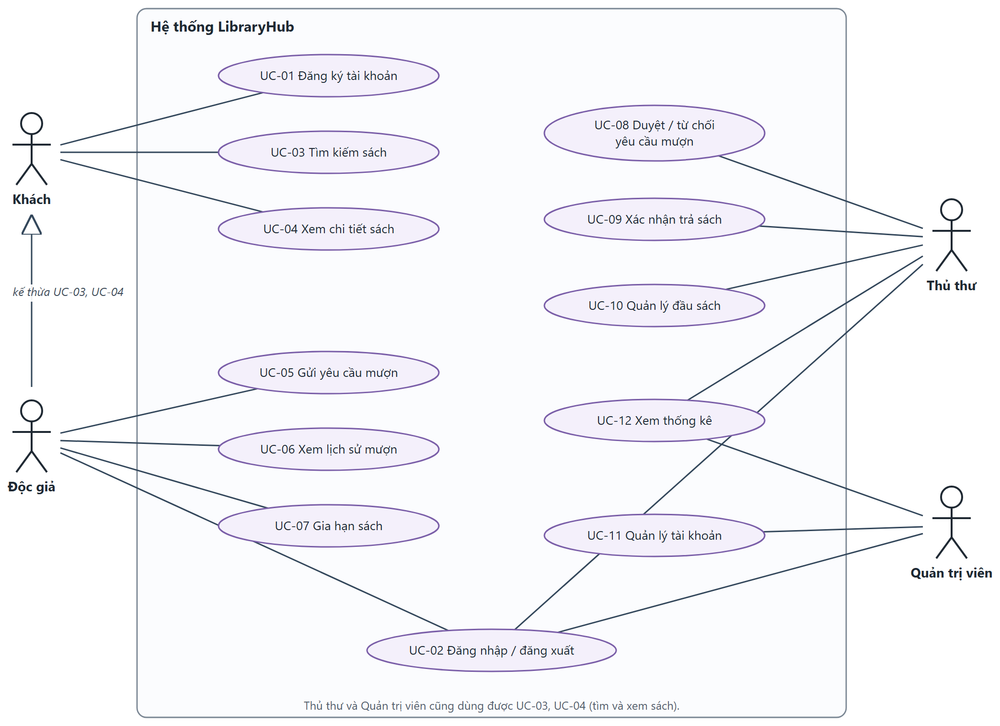

*Hình 2-1: Biểu đồ use case tổng quan*

### 2.4 Biểu đồ use case phân rã

Các use case nghiệp vụ mượn – trả được phân rã thành các thao tác con và quan hệ «include»/«extend»:

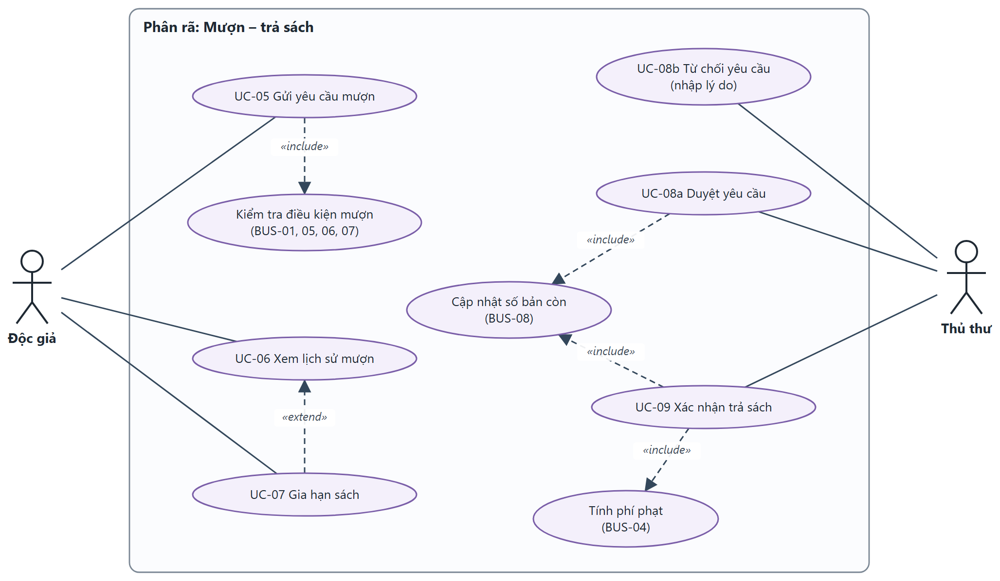

*Hình 2-2: Biểu đồ use case phân rã – Mượn, gia hạn, duyệt và trả sách*

Các use case quản lý (đầu sách, tài khoản, thống kê):

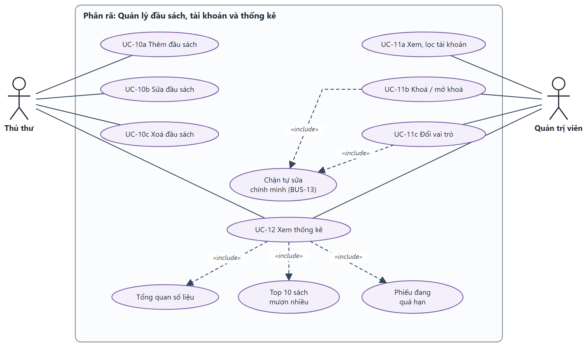

*Hình 2-3: Biểu đồ use case phân rã – Quản lý đầu sách, tài khoản và thống kê*

### 2.5 Quy trình nghiệp vụ

#### 2.5.1 Quy trình FLOW-01: Tìm sách → gửi yêu cầu mượn → thủ thư duyệt

**Tác nhân:** Độc giả, Thủ thư. **Tiền điều kiện:** độc giả ACTIVE đã đăng nhập; đầu sách tồn tại.

1. Độc giả nhập từ khoá ở trang Tìm sách (UC-03); hệ thống hiển thị kết quả có phân trang.

2. Độc giả mở chi tiết sách (UC-04), bấm "Gửi yêu cầu mượn".

3. Hệ thống kiểm tra BUS-01, BUS-05, BUS-07, BUS-06 theo thứ tự (Bảng 4-2), tạo phiếu PENDING, hiện MSG-09 (UC-05).

4. Thủ thư mở "Yêu cầu chờ duyệt", bấm Duyệt (UC-08); hệ thống chuyển phiếu BORROWING, đặt hạn trả, giảm availableCopies.

5. Độc giả thấy phiếu "Đang mượn" và hạn trả ở Lịch sử mượn (UC-06).

**Rẽ nhánh:** không có kết quả → MSG-12; khách bấm "Đăng nhập để mượn" → UC-02 rồi quay lại; vi phạm quy tắc → ERR-04 → ERR-07, không tạo phiếu; thủ thư từ chối kèm lý do → REJECTED; hết bản lúc duyệt → ERR-07, phiếu giữ PENDING.

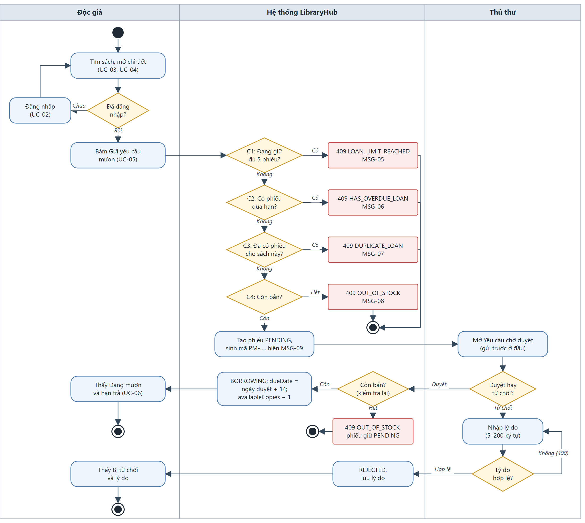

*Hình 2-4: Quy trình FLOW-01*

#### 2.5.2 Quy trình FLOW-02: Trả sách → tính phí phạt quá hạn

**Tác nhân:** Thủ thư (độc giả có mặt tại quầy). **Tiền điều kiện:** phiếu BORROWING hoặc OVERDUE.

1. Thủ thư mở "Quản lý phiếu mượn", tìm theo mã phiếu hoặc email (UC-09).

2. Hệ thống hiển thị phiếu, hạn trả, số ngày quá hạn và phí tạm tính.

3. Thủ thư bấm "Xác nhận trả" và xác nhận hộp thoại.

4. Hệ thống tính overdueDays, fine (BUS-04), chuyển RETURNED, tăng availableCopies, hiện MSG-16.

5. Độc giả thấy phiếu "Đã trả" và phí phạt ở Lịch sử mượn.

**Rẽ nhánh:** trả đúng/trước hạn → "Phí phạt: 0 đ"; quá hạn trên 50 ngày → phí dừng ở 100.000 đ; phiếu đã trả hoặc chưa duyệt → ERR-08, không đổi dữ liệu.

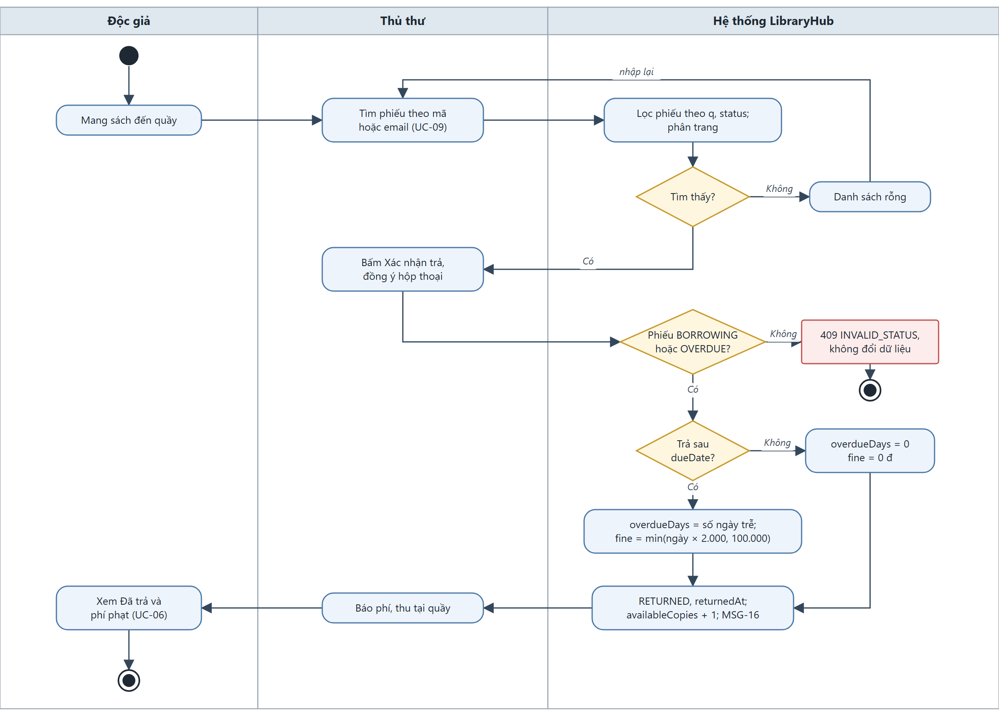

*Hình 2-5: Quy trình FLOW-02*

#### 2.5.3 Quy trình FLOW-03: Thủ thư thêm sách mới → độc giả tìm thấy và mượn được

**Tác nhân:** Thủ thư, Độc giả. **Tiền điều kiện:** hai tài khoản ACTIVE đúng vai trò; ISBN của sách mới chưa được dùng.

1. Thủ thư mở "Quản lý sách", bấm "Thêm sách", nhập dữ liệu (UC-10).

2. Hệ thống kiểm tra VAL-10 → VAL-14, tạo đầu sách với availableCopies = totalCopies.

3. Độc giả tìm theo tên hoặc ISBN của sách mới (UC-03) và thấy sách trong kết quả.

4. Độc giả mở chi tiết, thấy "Còn Y/Y bản", gửi yêu cầu mượn (UC-05).

5. Tiếp tục FLOW-01 từ bước 4.

**Rẽ nhánh:** ISBN trùng → ERR-11; dữ liệu sai → lỗi tại từng ô, không tạo sách; thủ thư sửa sách vừa thêm → độc giả thấy thông tin mới ngay.

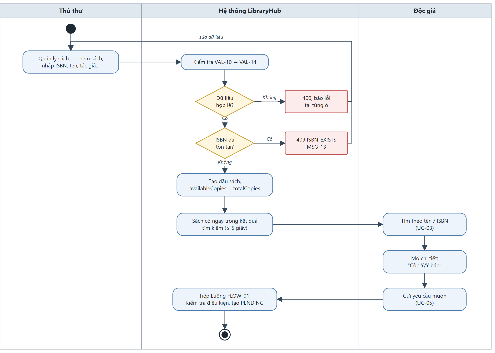

*Hình 2-6: Quy trình FLOW-03*

#### 2.5.4 Vòng đời phiếu mượn

Sơ đồ trạng thái phiếu mượn; nhãn tiếng Việt hiển thị theo DIS-04.

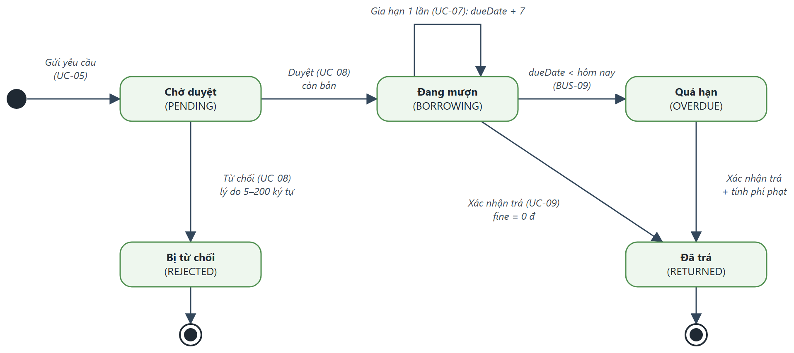

*Hình 2-7: Sơ đồ trạng thái phiếu mượn*

| Từ | Sự kiện / điều kiện | Đến | Nhãn hiển thị |
|---|---|---|---|
| (mới) | Gửi yêu cầu, đạt Bảng 4-2 cột R5 | PENDING | Chờ duyệt |
| PENDING | Duyệt, availableCopies > 0 | BORROWING | Đang mượn |
| PENDING | Từ chối, lý do hợp lệ (VAL-20) | REJECTED | Bị từ chối |
| BORROWING | Gia hạn, renewCount = 0 | BORROWING | Đang mượn |
| BORROWING | dueDate < hôm nay (BUS-09) | OVERDUE | Quá hạn |
| BORROWING | Xác nhận trả | RETURNED | Đã trả |
| OVERDUE | Xác nhận trả, chốt phí phạt | RETURNED | Đã trả |

*Bảng 2-4: Bảng chuyển trạng thái phiếu mượn*

**Chuyển trạng thái không hợp lệ** (ERR-08, 409 INVALID_STATUS, không thay đổi dữ liệu): duyệt/từ chối phiếu không ở PENDING; xác nhận trả phiếu PENDING/REJECTED/RETURNED; gia hạn phiếu khác BORROWING.

### 2.6 Đặc tả các use case

#### 2.6.1 UC-01: Đăng ký tài khoản

|  |  |
|---|---|
| **Mã Use case** | UC-01 |
| **Tên Use case** | Đăng ký tài khoản |
| **Tác nhân** | Khách |
| **Mô tả** | Khách tự tạo tài khoản vai trò Độc giả bằng email để dùng chức năng mượn sách. |
| **Sự kiện kích hoạt** | Khách bấm "Đăng ký" ở trang đăng nhập hoặc thanh đầu trang. |
| **Tiền điều kiện** | Người dùng chưa đăng nhập. |
| **Luồng sự kiện chính (Thành công)** | 1. *Khách*: Mở màn hình Đăng ký (SCR-02). 2. *Khách*: Nhập họ tên, email, số điện thoại, mật khẩu, xác nhận mật khẩu; bấm "Đăng ký". 3. *Hệ thống*: Kiểm tra VAL-01 → VAL-05 cho tất cả các trường. 4. *Hệ thống*: Chuẩn hoá email về chữ thường, kiểm tra trùng email. 5. *Hệ thống*: Băm mật khẩu (NFR-06), tạo tài khoản role = READER, status = ACTIVE; trả 201 không kèm mật khẩu. 6. *Hệ thống*: Hiện MSG-01 và chuyển tới màn hình Đăng nhập. |
| **Luồng sự kiện thay thế** | 3a. *Hệ thống*: Có trường không hợp lệ: trả 400 VALIDATION_ERROR, `fields` chứa **tất cả** lỗi; hiển thị lỗi dưới từng ô (ERR-01). Quay lại bước 2. 4a. *Hệ thống*: Email đã tồn tại (không phân biệt hoa thường): 409 EMAIL_EXISTS, hiện MSG-02 (ERR-02). Không tạo tài khoản. 1a. *Hệ thống*: Người đã đăng nhập mở trang Đăng ký: chuyển về trang chủ. |
| **Hậu điều kiện** | Tài khoản Độc giả ACTIVE được tạo; đăng nhập được bằng email và mật khẩu vừa đăng ký. |
| **Quy tắc nghiệp vụ** | Email duy nhất; vai trò luôn là READER; mật khẩu không bao giờ được trả về. |
| **Yêu cầu phi chức năng** | NFR-06 (băm mật khẩu bcrypt cost ≥ 10). |
| **Truy vết URD** | US-01 (AC-01.1 → AC-01.3) |

*Bảng 2-5: Đặc tả use case UC-01 – Đăng ký tài khoản*

* Dữ liệu đầu vào gồm các trường dữ liệu sau:

| STT | Trường dữ liệu | Mô tả | Bắt buộc? | Điều kiện hợp lệ | Ví dụ |
|---|---|---|---|---|---|
| 1 | fullName | Họ tên | Có | VAL-01: 2–50 ký tự sau khi cắt khoảng trắng; chỉ chữ cái và khoảng trắng | Nguyễn Văn An |
| 2 | email | Email đăng nhập | Có | VAL-02: đúng định dạng, ≤ 100 ký tự; chưa được dùng | an.nv@st.vju.ac.vn |
| 3 | phone | Số điện thoại | Có | VAL-03: đúng 10 chữ số, bắt đầu bằng 0 | 0912345678 |
| 4 | password | Mật khẩu | Có | VAL-04: 8–32 ký tự, có ít nhất 1 chữ cái và 1 chữ số | Thuvien2026 |
| 5 | confirmPassword | Xác nhận mật khẩu | Có | VAL-05: trùng password | Thuvien2026 |

*Bảng 2-6: Dữ liệu đầu vào của UC-01*

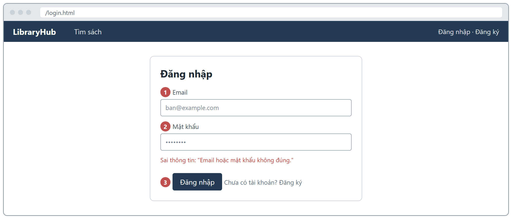

*Hình 2-8: Giao diện màn hình SCR-02 – Đăng ký*

#### 2.6.2 UC-02: Đăng nhập / đăng xuất

|  |  |
|---|---|
| **Mã Use case** | UC-02 |
| **Tên Use case** | Đăng nhập / đăng xuất |
| **Tác nhân** | Khách, Độc giả, Thủ thư, Quản trị viên |
| **Mô tả** | Người dùng có tài khoản đăng nhập để nhận token và dùng chức năng theo vai trò; đăng xuất để huỷ phiên. |
| **Sự kiện kích hoạt** | Người dùng mở trang Đăng nhập hoặc bấm "Đăng nhập để mượn"; bấm "Đăng xuất" ở thanh đầu trang. |
| **Tiền điều kiện** | Đăng nhập: chưa đăng nhập, đã có tài khoản. Đăng xuất: đang đăng nhập. |
| **Luồng sự kiện chính (Thành công)** | 1. *Người dùng*: Nhập email, mật khẩu ở SCR-01; bấm "Đăng nhập". 2. *Hệ thống*: Kiểm tra email và password là chuỗi không rỗng; so khớp email (không phân biệt hoa thường) và mật khẩu. 3. *Hệ thống*: Kiểm tra tài khoản không bị khoá (BUS-10). 4. *Hệ thống*: Cấp JWT hạn 60 phút chứa id, role; trả 200 với token, expiresIn = 3600 và thông tin người dùng. 5. *Hệ thống*: Chuyển trang theo vai trò: Độc giả → `/`, Thủ thư → `/librarian`, Quản trị viên → `/admin`; tên người dùng hiện ở thanh đầu trang. 6. *Người dùng*: Bấm "Đăng xuất". 7. *Hệ thống*: `POST /api/auth/logout` thu hồi token; giao diện xoá token và về trang Đăng nhập. |
| **Luồng sự kiện thay thế** | 2a. *Hệ thống*: Thiếu email/mật khẩu hoặc giá trị không phải chuỗi: 400 VALIDATION_ERROR ("Vui lòng nhập email", "Vui lòng nhập mật khẩu") (ERR-01). 2b. *Hệ thống*: Sai email hoặc mật khẩu: 401 INVALID_CREDENTIALS, MSG-03 (ERR-14); không nói rõ sai trường nào. 3a. *Hệ thống*: Tài khoản LOCKED: 403 ACCOUNT_LOCKED, MSG-04 (ERR-15). *a. *Hệ thống*: Gọi API bằng token đã hết hạn, sai hoặc đã đăng xuất: 401 UNAUTHORIZED, MSG-15 (ERR-09); giao diện chuyển về Đăng nhập. |
| **Hậu điều kiện** | Đăng nhập: có token hợp lệ 60 phút. Đăng xuất: token cũ không dùng lại được (kể cả bằng nút Back). |
| **Quy tắc nghiệp vụ** | BUS-10. Thông tin phiên hiện tại: `GET /api/auth/me`. |
| **Yêu cầu phi chức năng** | NFR-02 (đăng nhập), NFR-07 (401/403, hạn token). |
| **Truy vết URD** | US-02 (AC-02.1 → AC-02.4) |

*Bảng 2-7: Đặc tả use case UC-02 – Đăng nhập / đăng xuất*

* Dữ liệu đầu vào gồm các trường dữ liệu sau:

| STT | Trường dữ liệu | Mô tả | Bắt buộc? | Điều kiện hợp lệ | Ví dụ |
|---|---|---|---|---|---|
| 1 | email | Email đăng nhập | Có | Chuỗi không rỗng, ≤ 100 ký tự | reader1@libraryhub.vn |
| 2 | password | Mật khẩu | Có | Chuỗi không rỗng | (mật khẩu tài khoản thử) |

*Bảng 2-8: Dữ liệu đầu vào của UC-02*

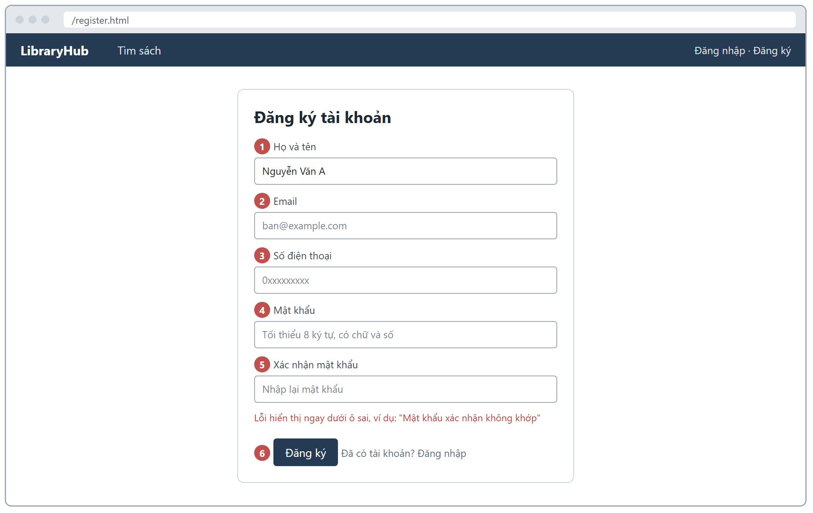

*Hình 2-9: Giao diện màn hình SCR-01 – Đăng nhập*

#### 2.6.3 UC-03: Tìm kiếm sách

|  |  |
|---|---|
| **Mã Use case** | UC-03 |
| **Tên Use case** | Tìm kiếm sách |
| **Tác nhân** | Tất cả (kể cả Khách) |
| **Mô tả** | Tìm đầu sách theo từ khoá, lọc theo thể loại và tình trạng còn sách, sắp xếp và phân trang kết quả. |
| **Sự kiện kích hoạt** | Người dùng mở trang chủ (Tìm sách) hoặc bấm "Tìm". |
| **Tiền điều kiện** | Không có. |
| **Luồng sự kiện chính (Thành công)** | 1. *Người dùng*: Nhập từ khoá và/hoặc chọn thể loại, "Chỉ sách còn", sắp xếp; bấm "Tìm". 2. *Hệ thống*: Kiểm tra VAL-15, VAL-16 và giá trị category/available/sort. 3. *Hệ thống*: Lọc đầu sách chưa xoá: q khớp một phần, không phân biệt hoa thường, trên tên, tác giả hoặc ISBN; áp dụng đồng thời mọi bộ lọc. 4. *Hệ thống*: Sắp xếp (newest: createdAt giảm dần – mặc định; title: A→Z), phân trang; trả danh sách và pagination {page, size, totalItems, totalPages}. 5. *Hệ thống*: Hiển thị lưới sách 12 cuốn/trang (DIS-05): ảnh bìa, tên, tác giả, thể loại, "Còn X/Y bản" và điều hướng trang. |
| **Luồng sự kiện thay thế** | 4a. *Hệ thống*: Không có kết quả: danh sách rỗng, hiển thị MSG-12 "Không tìm thấy sách phù hợp." 2a. *Hệ thống*: Tham số sai (q > 100 ký tự, page < 1, size ngoài 1–50, category/sort/available không hợp lệ): 400 VALIDATION_ERROR (ERR-01). |
| **Hậu điều kiện** | Người dùng thấy danh sách sách phù hợp với điều kiện tìm. |
| **Quy tắc nghiệp vụ** | totalItems là số đầu sách thoả **tất cả** điều kiện lọc đang áp dụng; totalPages = ⌈totalItems / size⌉. Không trả đầu sách đã xoá (BUS-11). Danh mục thể loại: `GET /api/categories`. |
| **Yêu cầu phi chức năng** | NFR-01 (p95 ≤ 1.000 ms, 50 người dùng), NFR-04, NFR-05. |
| **Truy vết URD** | US-03 (AC-03.1 → AC-03.3) |

*Bảng 2-9: Đặc tả use case UC-03 – Tìm kiếm sách*

* Dữ liệu đầu vào gồm các trường dữ liệu sau:

| STT | Trường dữ liệu | Mô tả | Bắt buộc? | Điều kiện hợp lệ | Ví dụ |
|---|---|---|---|---|---|
| 1 | q | Từ khoá | Không | VAL-15: ≤ 100 ký tự | lập trình |
| 2 | category | Thể loại | Không | Một trong 8 thể loại (Bảng 4-8) | Công nghệ thông tin |
| 3 | available | Chỉ sách còn bản | Không | "true" hoặc "false" | true |
| 4 | sort | Sắp xếp | Không | "title" hoặc "newest" (mặc định) | title |
| 5 | page | Trang | Không | VAL-16: số nguyên ≥ 1, mặc định 1 | 2 |
| 6 | size | Số mục mỗi trang | Không | VAL-16: 1–50, mặc định 10; giao diện dùng 12 | 12 |

*Bảng 2-10: Dữ liệu đầu vào của UC-03*

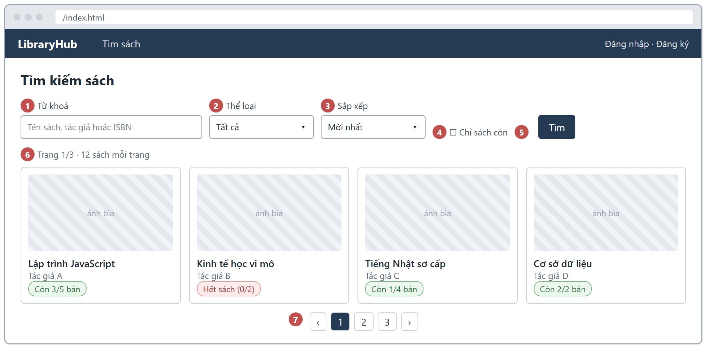

*Hình 2-10: Giao diện màn hình SCR-03 – Tìm sách (trang chủ)*

#### 2.6.4 UC-04: Xem chi tiết sách

|  |  |
|---|---|
| **Mã Use case** | UC-04 |
| **Tên Use case** | Xem chi tiết sách |
| **Tác nhân** | Tất cả (kể cả Khách) |
| **Mô tả** | Xem đầy đủ thông tin một đầu sách và số bản còn lại để quyết định mượn. |
| **Sự kiện kích hoạt** | Người dùng bấm vào một sách trong kết quả tìm kiếm hoặc mở đường dẫn `/books/{id}`. |
| **Tiền điều kiện** | Không có. |
| **Luồng sự kiện chính (Thành công)** | 1. *Người dùng*: Chọn một đầu sách. 2. *Hệ thống*: `GET /api/books/{id}` trả 200 với toàn bộ trường của đầu sách. 3. *Hệ thống*: Hiển thị ảnh bìa, tên, tác giả, ISBN, thể loại, nhà xuất bản, năm xuất bản, mô tả và "Còn X/Y bản" (DIS-09). 4. *Hệ thống*: Độc giả: hiện nút "Gửi yêu cầu mượn" (sang UC-05). Khách: hiện nút "Đăng nhập để mượn". |
| **Luồng sự kiện thay thế** | 3a. *Hệ thống*: X = 0: hiện nhãn "Hết sách", nút "Gửi yêu cầu mượn" bị vô hiệu. 2a. *Hệ thống*: id không tồn tại, đã xoá hoặc không phải số nguyên dương: 404 NOT_FOUND "Không tìm thấy sách." (ERR-03). 4a. *Khách*: Bấm "Đăng nhập để mượn" → UC-02 → quay về trang chi tiết sách. |
| **Hậu điều kiện** | Người dùng thấy đầy đủ thông tin sách. |
| **Quy tắc nghiệp vụ** | BUS-11 (sách đã xoá không xem được). Ảnh bìa trống → ảnh mặc định (DIS-10). |
| **Yêu cầu phi chức năng** | NFR-02 (trung bình ≤ 500 ms), NFR-05 (≤ 3 giây, ≤ 2 MB). |
| **Truy vết URD** | US-04 (AC-04.1, AC-04.2) |

*Bảng 2-11: Đặc tả use case UC-04 – Xem chi tiết sách*

* Dữ liệu đầu vào gồm các trường dữ liệu sau:

| STT | Trường dữ liệu | Mô tả | Bắt buộc? | Điều kiện hợp lệ | Ví dụ |
|---|---|---|---|---|---|
| 1 | id | Mã đầu sách (trên đường dẫn) | Có | Số nguyên dương của đầu sách đang tồn tại | 12 |

*Bảng 2-12: Dữ liệu đầu vào của UC-04*

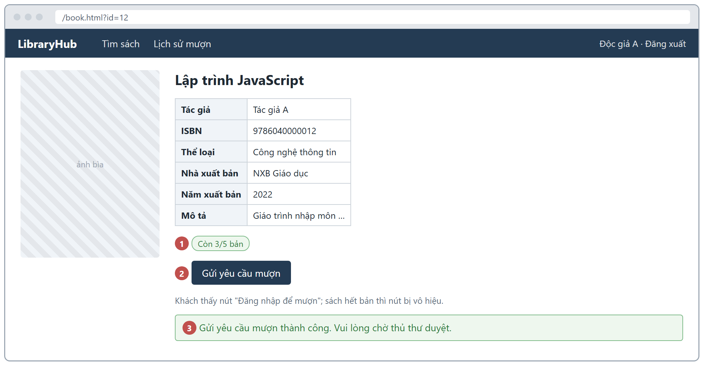

*Hình 2-11: Giao diện màn hình SCR-04 – Chi tiết sách*

#### 2.6.5 UC-05: Gửi yêu cầu mượn

|  |  |
|---|---|
| **Mã Use case** | UC-05 |
| **Tên Use case** | Gửi yêu cầu mượn |
| **Tác nhân** | Độc giả |
| **Mô tả** | Độc giả gửi yêu cầu mượn một bản của đầu sách; hệ thống kiểm tra các quy tắc mượn trước khi tạo phiếu. |
| **Sự kiện kích hoạt** | Độc giả bấm "Gửi yêu cầu mượn" ở SCR-04. |
| **Tiền điều kiện** | Độc giả ACTIVE đã đăng nhập; đầu sách tồn tại. |
| **Luồng sự kiện chính (Thành công)** | 1. *Độc giả*: Bấm "Gửi yêu cầu mượn". 2. *Hệ thống*: Cập nhật quá hạn tự động (BUS-09). 3. *Hệ thống*: Kiểm tra theo thứ tự C1 → C4 của Bảng 4-2: giới hạn 5 cuốn (BUS-01), có phiếu quá hạn (BUS-05), trùng đầu sách (BUS-07), còn bản (BUS-06). 4. *Hệ thống*: Tạo phiếu PENDING, sinh code PM-YYYYMMDD-NNNN, requestedAt = hiện tại; trả 201. availableCopies không đổi (BUS-08). 5. *Hệ thống*: Hiện MSG-09; phiếu "Chờ duyệt" xuất hiện trong Lịch sử mượn. |
| **Luồng sự kiện thay thế** | 3a. *Hệ thống*: Đang có 5 phiếu chưa kết thúc (tính cả PENDING): 409 LOAN_LIMIT_REACHED, MSG-05 (ERR-04). 3b. *Hệ thống*: Có phiếu OVERDUE: 409 HAS_OVERDUE_LOAN, MSG-06 (ERR-05). 3c. *Hệ thống*: Đã có phiếu chưa kết thúc cho đầu sách này: 409 DUPLICATE_LOAN, MSG-07 (ERR-06). 3d. *Hệ thống*: availableCopies = 0: 409 OUT_OF_STOCK, MSG-08 (ERR-07). 1a. *Hệ thống*: bookId không hợp lệ: 400 (ERR-01); bookId không tồn tại hoặc đã xoá: 404 (ERR-03). |
| **Hậu điều kiện** | Thành công: một phiếu PENDING mới. Thất bại: không tạo phiếu, dữ liệu không đổi; chỉ báo lỗi của điều kiện đầu tiên không đạt. |
| **Quy tắc nghiệp vụ** | BUS-01, BUS-05, BUS-06, BUS-07, BUS-08, BUS-09; Bảng 4-2. |
| **Yêu cầu phi chức năng** | NFR-03 (p95 ≤ 1.500 ms, lỗi < 1%, 30 người dùng). |
| **Truy vết URD** | US-05 (AC-05.1 → AC-05.4) |

*Bảng 2-13: Đặc tả use case UC-05 – Gửi yêu cầu mượn*

* Dữ liệu đầu vào gồm các trường dữ liệu sau:

| STT | Trường dữ liệu | Mô tả | Bắt buộc? | Điều kiện hợp lệ | Ví dụ |
|---|---|---|---|---|---|
| 1 | bookId | Mã đầu sách muốn mượn | Có | Số nguyên dương của đầu sách đang tồn tại | 12 |

*Bảng 2-14: Dữ liệu đầu vào của UC-05*

* Giao diện: màn hình SCR-04 – Chi tiết sách (nút "Gửi yêu cầu mượn") (xem Hình 2-11).

#### 2.6.6 UC-06: Xem lịch sử mượn

|  |  |
|---|---|
| **Mã Use case** | UC-06 |
| **Tên Use case** | Xem lịch sử mượn |
| **Tác nhân** | Độc giả |
| **Mô tả** | Độc giả xem các phiếu mượn của chính mình, hạn trả, trạng thái và phí phạt. |
| **Sự kiện kích hoạt** | Độc giả mở mục "Lịch sử mượn". |
| **Tiền điều kiện** | Độc giả ACTIVE đã đăng nhập. |
| **Luồng sự kiện chính (Thành công)** | 1. *Độc giả*: Mở SCR-05, chọn lọc trạng thái (tuỳ chọn). 2. *Hệ thống*: Cập nhật quá hạn tự động (BUS-09). 3. *Hệ thống*: `GET /api/loans/me` trả các phiếu của người gọi, requestedAt giảm dần, phân trang (giao diện 10 phiếu/trang). 4. *Hệ thống*: Hiển thị mã phiếu, tên sách, ngày yêu cầu, hạn trả, trạng thái (DIS-04), ngày trả, phí phạt (DIS-02), lý do từ chối; ngày dạng dd/mm/yyyy (DIS-03). |
| **Luồng sự kiện thay thế** | 3a. *Hệ thống*: Phiếu OVERDUE: fine là phí **tạm tính** đến hôm nay theo BUS-04 (2.000 đ/ngày, tối đa 100.000 đ). 3b. *Hệ thống*: Mở `GET /api/loans/{id}` của độc giả khác: 404 "Không tìm thấy phiếu mượn." (ERR-03). 1a. *Hệ thống*: status không thuộc danh mục: 400 "Trạng thái không hợp lệ" (ERR-01). |
| **Hậu điều kiện** | Độc giả thấy đúng và đủ phiếu của mình. |
| **Quy tắc nghiệp vụ** | BUS-04, BUS-09; chỉ dữ liệu của chính người gọi. |
| **Yêu cầu phi chức năng** | NFR-02 (trung bình ≤ 500 ms), NFR-11. |
| **Truy vết URD** | US-06 (AC-06.1 → AC-06.3) |

*Bảng 2-15: Đặc tả use case UC-06 – Xem lịch sử mượn*

* Dữ liệu đầu vào gồm các trường dữ liệu sau:

| STT | Trường dữ liệu | Mô tả | Bắt buộc? | Điều kiện hợp lệ | Ví dụ |
|---|---|---|---|---|---|
| 1 | status | Lọc trạng thái | Không | PENDING, BORROWING, OVERDUE, RETURNED, REJECTED | OVERDUE |
| 2 | page | Trang | Không | VAL-16 | 1 |
| 3 | size | Số mục mỗi trang | Không | VAL-16; giao diện dùng 10 | 10 |

*Bảng 2-16: Dữ liệu đầu vào của UC-06*

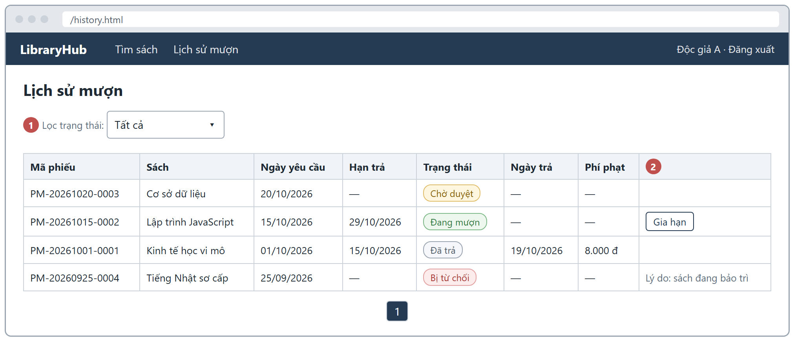

*Hình 2-12: Giao diện màn hình SCR-05 – Lịch sử mượn*

#### 2.6.7 UC-07: Gia hạn sách

|  |  |
|---|---|
| **Mã Use case** | UC-07 |
| **Tên Use case** | Gia hạn sách |
| **Tác nhân** | Độc giả |
| **Mô tả** | Độc giả lùi hạn trả của một phiếu đang mượn thêm 7 ngày, tối đa 1 lần. |
| **Sự kiện kích hoạt** | Độc giả bấm "Gia hạn" trên một phiếu ở SCR-05. |
| **Tiền điều kiện** | Độc giả đã đăng nhập; phiếu BORROWING, renewCount = 0 (nút chỉ hiện trong trường hợp này). |
| **Luồng sự kiện chính (Thành công)** | 1. *Độc giả*: Bấm "Gia hạn". 2. *Hệ thống*: Cập nhật quá hạn tự động (BUS-09); kiểm tra Bảng 4-3. 3. *Hệ thống*: dueDate mới = dueDate hiện tại + 7 ngày; renewCount = 1; trả 200. 4. *Hệ thống*: Hiện MSG-10 "Gia hạn thành công. Hạn trả mới: dd/mm/yyyy." |
| **Luồng sự kiện thay thế** | 2a. *Hệ thống*: Phiếu không thuộc người gọi hoặc không tồn tại: 404 (ERR-03). 2b. *Hệ thống*: Phiếu không ở BORROWING (kể cả đã quá hạn): 409 INVALID_STATUS "Chỉ gia hạn được phiếu đang mượn và chưa quá hạn." (ERR-08). 2c. *Hệ thống*: renewCount = 1: 409 RENEW_LIMIT_REACHED, MSG-11 (ERR-10). |
| **Hậu điều kiện** | Phiếu có hạn trả mới, renewCount = 1, vẫn ở BORROWING. |
| **Quy tắc nghiệp vụ** | BUS-03, BUS-09; Bảng 4-3. |
| **Yêu cầu phi chức năng** | NFR-07 (chỉ Độc giả, chỉ phiếu của mình). |
| **Truy vết URD** | US-07 (AC-07.1, AC-07.2) |

*Bảng 2-17: Đặc tả use case UC-07 – Gia hạn sách*

* Dữ liệu đầu vào gồm các trường dữ liệu sau:

| STT | Trường dữ liệu | Mô tả | Bắt buộc? | Điều kiện hợp lệ | Ví dụ |
|---|---|---|---|---|---|
| 1 | id | Mã phiếu mượn (trên đường dẫn) | Có | Số nguyên dương; phiếu của người gọi | 58 |

*Bảng 2-18: Dữ liệu đầu vào của UC-07*

* Giao diện: màn hình SCR-05 – Lịch sử mượn (nút "Gia hạn") (xem Hình 2-12).

#### 2.6.8 UC-08: Duyệt / từ chối yêu cầu mượn

|  |  |
|---|---|
| **Mã Use case** | UC-08 |
| **Tên Use case** | Duyệt / từ chối yêu cầu mượn |
| **Tác nhân** | Thủ thư |
| **Mô tả** | Thủ thư duyệt hoặc từ chối các yêu cầu chờ duyệt theo thứ tự gửi trước xử lý trước. |
| **Sự kiện kích hoạt** | Thủ thư mở "Yêu cầu chờ duyệt". |
| **Tiền điều kiện** | Thủ thư ACTIVE đã đăng nhập; có phiếu PENDING. |
| **Luồng sự kiện chính (Thành công)** | 1. *Thủ thư*: Mở SCR-06. 2. *Hệ thống*: `GET /api/librarian/loans?status=PENDING`: phiếu PENDING, requestedAt **tăng dần**, kèm tên, email độc giả, tên sách, số bản còn, thời điểm gửi. 3. *Thủ thư*: Bấm "Duyệt" trên một phiếu. 4. *Hệ thống*: Kiểm tra phiếu PENDING và availableCopies > 0; nguyên tử: chuyển BORROWING, approvedAt = hiện tại, dueDate = ngày duyệt + 14 ngày (BUS-02), availableCopies − 1 (BUS-08). 5. *Hệ thống*: Phiếu biến khỏi danh sách chờ duyệt. |
| **Luồng sự kiện thay thế** | 3a. *Thủ thư*: Bấm "Từ chối", nhập lý do trong hộp thoại "Lý do từ chối". 4a. *Hệ thống*: Lý do hợp lệ (VAL-20): chuyển REJECTED, lưu lý do; availableCopies **không đổi**. Lý do sai: 400 (ERR-01). 4b. *Hệ thống*: Đầu sách hết bản: 409 OUT_OF_STOCK "Sách đã hết, không thể duyệt." (ERR-07); phiếu giữ PENDING. 4c. *Hệ thống*: Phiếu không còn PENDING: 409 INVALID_STATUS (ERR-08). Phiếu không tồn tại: 404 (ERR-03). 4d. *Hệ thống*: Hai thủ thư duyệt cùng lúc bản cuối cùng: chỉ một yêu cầu thành công, yêu cầu còn lại nhận ERR-07. |
| **Hậu điều kiện** | Phiếu ở BORROWING (có hạn trả) hoặc REJECTED (có lý do); availableCopies đúng BUS-08. |
| **Quy tắc nghiệp vụ** | BUS-02, BUS-06, BUS-08; VAL-20. |
| **Yêu cầu phi chức năng** | NFR-03 (duyệt: p95 ≤ 1.500 ms), NFR-13 (toàn vẹn số bản). |
| **Truy vết URD** | US-08 (AC-08.1 → AC-08.3) |

*Bảng 2-19: Đặc tả use case UC-08 – Duyệt / từ chối yêu cầu mượn*

* Dữ liệu đầu vào gồm các trường dữ liệu sau:

| STT | Trường dữ liệu | Mô tả | Bắt buộc? | Điều kiện hợp lệ | Ví dụ |
|---|---|---|---|---|---|
| 1 | id | Mã phiếu (trên đường dẫn) | Có | Phiếu đang tồn tại | 61 |
| 2 | reason | Lý do từ chối | Khi từ chối | VAL-20: 5–200 ký tự | Sách đang được bảo trì |

*Bảng 2-20: Dữ liệu đầu vào của UC-08*

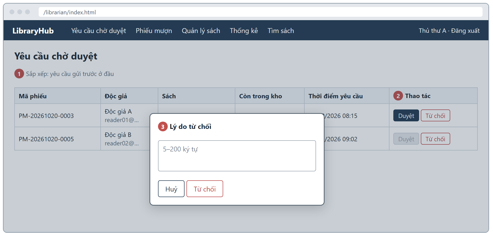

*Hình 2-13: Giao diện màn hình SCR-06 – Yêu cầu chờ duyệt*

#### 2.6.9 UC-09: Xác nhận trả sách

|  |  |
|---|---|
| **Mã Use case** | UC-09 |
| **Tên Use case** | Xác nhận trả sách |
| **Tác nhân** | Thủ thư |
| **Mô tả** | Thủ thư ghi nhận độc giả trả sách; hệ thống tự tính số ngày quá hạn và phí phạt. |
| **Sự kiện kích hoạt** | Độc giả mang sách đến quầy; thủ thư mở "Quản lý phiếu mượn". |
| **Tiền điều kiện** | Thủ thư ACTIVE đã đăng nhập; phiếu BORROWING hoặc OVERDUE. |
| **Luồng sự kiện chính (Thành công)** | 1. *Thủ thư*: Tìm phiếu theo mã phiếu hoặc email độc giả, lọc trạng thái (SCR-07). 2. *Hệ thống*: `GET /api/librarian/loans`: hiển thị phiếu, hạn trả, số ngày quá hạn và phí tạm tính; 20 phiếu/trang. 3. *Thủ thư*: Bấm "Xác nhận trả", đồng ý ở hộp thoại xác nhận. 4. *Hệ thống*: Tính overdueDays, fine theo BUS-04; chuyển RETURNED, returnedAt = hiện tại; availableCopies + 1 (BUS-08). 5. *Hệ thống*: Hiện MSG-16 "Đã xác nhận trả sách. Phí phạt: X đ." |
| **Luồng sự kiện thay thế** | 4a. *Hệ thống*: Trả đúng hoặc trước hạn: overdueDays = 0, "Phí phạt: 0 đ". 4b. *Hệ thống*: Trễ trên 50 ngày: phí dừng ở 100.000 đ (Bảng 4-4). 3a. *Hệ thống*: Phiếu PENDING/REJECTED/RETURNED: 409 INVALID_STATUS (ERR-08), không đổi dữ liệu. 1a. *Hệ thống*: Không tìm thấy phiếu: danh sách rỗng. |
| **Hậu điều kiện** | Phiếu RETURNED có returnedAt, overdueDays, fine; độc giả hết bị chặn bởi BUS-05 nếu không còn phiếu quá hạn khác. |
| **Quy tắc nghiệp vụ** | BUS-04, BUS-08, BUS-09; Bảng 4-4. |
| **Yêu cầu phi chức năng** | NFR-13. |
| **Truy vết URD** | US-09 (AC-09.1 → AC-09.3) |

*Bảng 2-21: Đặc tả use case UC-09 – Xác nhận trả sách*

* Dữ liệu đầu vào gồm các trường dữ liệu sau:

| STT | Trường dữ liệu | Mô tả | Bắt buộc? | Điều kiện hợp lệ | Ví dụ |
|---|---|---|---|---|---|
| 1 | q | Mã phiếu hoặc email độc giả | Không | ≤ 100 ký tự; khớp một phần | PM-20261020 |
| 2 | status | Lọc trạng thái | Không | Một trong 5 trạng thái | OVERDUE |
| 3 | id | Mã phiếu cần xác nhận trả | Có | Phiếu BORROWING hoặc OVERDUE | 47 |

*Bảng 2-22: Dữ liệu đầu vào của UC-09*

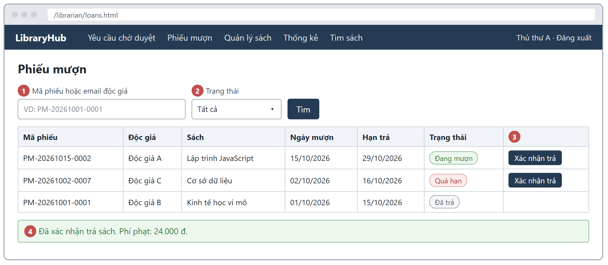

*Hình 2-14: Giao diện màn hình SCR-07 – Quản lý phiếu mượn*

#### 2.6.10 UC-10: Thêm / sửa / xoá sách

|  |  |
|---|---|
| **Mã Use case** | UC-10 |
| **Tên Use case** | Thêm / sửa / xoá sách |
| **Tác nhân** | Thủ thư |
| **Mô tả** | Thủ thư cập nhật danh mục đầu sách cho đúng với kho. |
| **Sự kiện kích hoạt** | Thủ thư bấm "Thêm sách", "Sửa" hoặc "Xoá" ở SCR-08. |
| **Tiền điều kiện** | Thủ thư ACTIVE đã đăng nhập. |
| **Luồng sự kiện chính (Thành công)** | 1. *Thủ thư*: Bấm "Thêm sách", nhập dữ liệu, bấm "Lưu". 2. *Hệ thống*: Kiểm tra VAL-10 → VAL-14 và các trường tuỳ chọn; kiểm tra ISBN chưa tồn tại. 3. *Hệ thống*: Tạo đầu sách, availableCopies = totalCopies; trả 201. 4. *Hệ thống*: Đầu sách xuất hiện ngay trong UC-03, UC-04 (không cache quá 5 giây). |
| **Luồng sự kiện thay thế** | 1a. *Thủ thư*: Sửa: cập nhật các trường được gửi (`PUT /api/books/{id}`). ISBN trùng với đầu sách khác: 409 (ERR-11). totalCopies mới < số bản đang cho mượn: 409 COPIES_IN_USE (ERR-12); hợp lệ thì availableCopies được tính lại (BUS-12). 1b. *Thủ thư*: Xoá: hệ thống hỏi xác nhận; đầu sách còn phiếu chưa kết thúc → 409 BOOK_IN_USE, MSG-14 (ERR-13); không thì xoá mềm (BUS-11). 2a. *Hệ thống*: Dữ liệu sai: 400, lỗi tại từng ô (ERR-01). ISBN trùng: 409 ISBN_EXISTS, MSG-13 (ERR-11). 1c. *Hệ thống*: Đầu sách không tồn tại khi sửa/xoá: 404 (ERR-03). |
| **Hậu điều kiện** | Danh mục sách được cập nhật; availableCopies luôn trong 0 – totalCopies. |
| **Quy tắc nghiệp vụ** | BUS-11, BUS-12; VAL-10 → VAL-14. |
| **Yêu cầu phi chức năng** | NFR-13. |
| **Truy vết URD** | US-10 (AC-10.1 → AC-10.3) |

*Bảng 2-23: Đặc tả use case UC-10 – Thêm / sửa / xoá sách*

* Dữ liệu đầu vào gồm các trường dữ liệu sau:

| STT | Trường dữ liệu | Mô tả | Bắt buộc? | Điều kiện hợp lệ | Ví dụ |
|---|---|---|---|---|---|
| 1 | isbn | Mã ISBN | Có | VAL-10: đúng 13 chữ số; duy nhất | 9786041234567 |
| 2 | title | Tên sách | Có | VAL-11: 1–200 ký tự | Lập trình Node.js |
| 3 | author | Tác giả | Có | VAL-12: 1–100 ký tự | Trần Minh |
| 4 | category | Thể loại | Có | Một trong 8 thể loại | Công nghệ thông tin |
| 5 | publisher | Nhà xuất bản | Không | ≤ 100 ký tự | NXB Trẻ |
| 6 | publishYear | Năm xuất bản | Không | VAL-13: 1900 – năm hiện tại | 2024 |
| 7 | totalCopies | Tổng số bản | Có | VAL-14: 1–100; khi sửa ≥ số bản đang cho mượn | 5 |
| 8 | description | Mô tả | Không | ≤ 2000 ký tự | Giáo trình… |
| 9 | coverUrl | Ảnh bìa | Không | URL http/https, ≤ 500 ký tự | https://…/bia.jpg |

*Bảng 2-24: Dữ liệu đầu vào của UC-10*

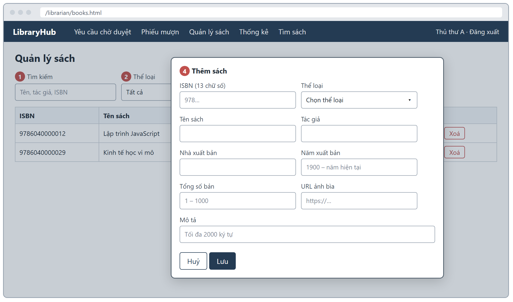

*Hình 2-15: Giao diện màn hình SCR-08 – Quản lý sách*

#### 2.6.11 UC-11: Quản lý tài khoản

|  |  |
|---|---|
| **Mã Use case** | UC-11 |
| **Tên Use case** | Quản lý tài khoản |
| **Tác nhân** | Quản trị viên |
| **Mô tả** | Quản trị viên tìm tài khoản, khoá/mở khoá và đổi vai trò. |
| **Sự kiện kích hoạt** | Quản trị viên mở "Quản trị" (SCR-09). |
| **Tiền điều kiện** | Quản trị viên ACTIVE đã đăng nhập. |
| **Luồng sự kiện chính (Thành công)** | 1. *Quản trị viên*: Tìm theo tên/email, lọc vai trò và trạng thái; 20 tài khoản/trang. 2. *Hệ thống*: `GET /api/admin/users` trả danh sách, **không bao giờ** kèm mật khẩu hay mã băm. 3. *Quản trị viên*: Bấm "Khoá"/"Mở khoá" hoặc chọn vai trò mới trên một dòng. 4. *Hệ thống*: `PATCH /api/admin/users/{id}/status` hoặc `/role`: lưu thay đổi; trả 200. 5. *Hệ thống*: Tài khoản bị khoá nhận 403 ACCOUNT_LOCKED ngay ở lần gọi API kế tiếp (BUS-10). |
| **Luồng sự kiện thay thế** | 4a. *Hệ thống*: Quản trị viên đổi trạng thái **hoặc vai trò** của chính mình: 409 SELF_MODIFICATION (ERR-17), không đổi dữ liệu. 4b. *Hệ thống*: status ngoài ACTIVE/LOCKED hoặc role ngoài READER/LIBRARIAN/ADMIN: 400 (ERR-01). 4c. *Hệ thống*: Tài khoản không tồn tại: 404 "Không tìm thấy tài khoản." (ERR-03). |
| **Hậu điều kiện** | Trạng thái hoặc vai trò của tài khoản đích được cập nhật. |
| **Quy tắc nghiệp vụ** | BUS-10, BUS-13. |
| **Yêu cầu phi chức năng** | NFR-06, NFR-07. |
| **Truy vết URD** | US-11 (AC-11.1, AC-11.2) |

*Bảng 2-25: Đặc tả use case UC-11 – Quản lý tài khoản*

* Dữ liệu đầu vào gồm các trường dữ liệu sau:

| STT | Trường dữ liệu | Mô tả | Bắt buộc? | Điều kiện hợp lệ | Ví dụ |
|---|---|---|---|---|---|
| 1 | q | Tên hoặc email | Không | ≤ 100 ký tự | nguyen |
| 2 | status | Trạng thái mới | Khi khoá/mở | ACTIVE hoặc LOCKED | LOCKED |
| 3 | role | Vai trò mới | Khi đổi vai trò | READER, LIBRARIAN hoặc ADMIN | LIBRARIAN |

*Bảng 2-26: Dữ liệu đầu vào của UC-11*

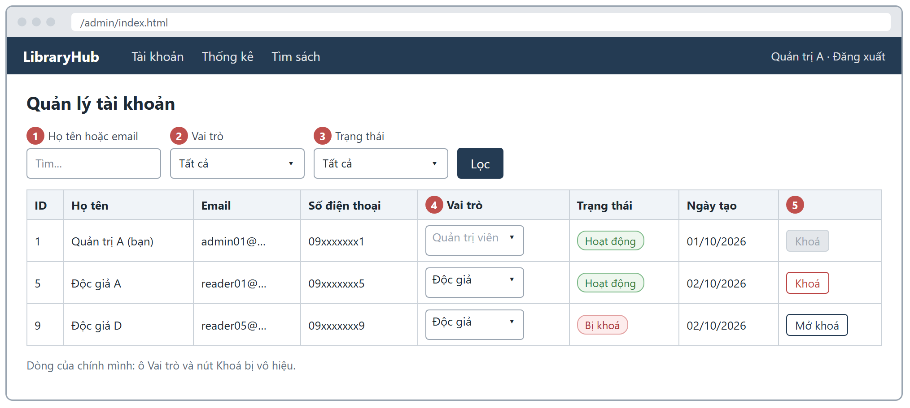

*Hình 2-16: Giao diện màn hình SCR-09 – Quản trị tài khoản*

#### 2.6.12 UC-12: Xem thống kê

|  |  |
|---|---|
| **Mã Use case** | UC-12 |
| **Tên Use case** | Xem thống kê |
| **Tác nhân** | Thủ thư, Quản trị viên |
| **Mô tả** | Xem số liệu tổng quan, 10 sách được mượn nhiều nhất trong khoảng thời gian và danh sách phiếu quá hạn. |
| **Sự kiện kích hoạt** | Người dùng mở "Thống kê" (SCR-10) hoặc đổi khoảng thời gian. |
| **Tiền điều kiện** | Thủ thư hoặc Quản trị viên ACTIVE đã đăng nhập. |
| **Luồng sự kiện chính (Thành công)** | 1. *Người dùng*: Chọn khoảng thời gian (mặc định 30 ngày gần nhất). 2. *Hệ thống*: Cập nhật quá hạn tự động (BUS-09); kiểm tra VAL-21. 3. *Hệ thống*: `GET /api/stats/summary`: tổng đầu sách, tổng bản, số phiếu theo trạng thái, tổng độc giả. 4. *Hệ thống*: `GET /api/stats/top-books`: tối đa 10 đầu sách có số phiếu được duyệt (approvedAt trong khoảng) nhiều nhất, giảm dần; bằng nhau xếp theo tên A→Z. 5. *Hệ thống*: `GET /api/stats/overdue`: các phiếu OVERDUE với độc giả, tên sách, hạn trả, số ngày quá hạn, phí tạm tính; số ngày quá hạn giảm dần. |
| **Luồng sự kiện thay thế** | 2a. *Hệ thống*: from > to, cách nhau quá 366 ngày, sai định dạng hoặc ngày không có thật (ví dụ 2026-02-30): 400 "Khoảng thời gian không hợp lệ" (ERR-01). |
| **Hậu điều kiện** | Người dùng thấy số liệu đúng tại thời điểm xem. |
| **Quy tắc nghiệp vụ** | BUS-04, BUS-09; VAL-21. |
| **Yêu cầu phi chức năng** | NFR-07. |
| **Truy vết URD** | US-12 (AC-12.1 → AC-12.3) |

*Bảng 2-27: Đặc tả use case UC-12 – Xem thống kê*

* Dữ liệu đầu vào gồm các trường dữ liệu sau:

| STT | Trường dữ liệu | Mô tả | Bắt buộc? | Điều kiện hợp lệ | Ví dụ |
|---|---|---|---|---|---|
| 1 | from | Từ ngày | Không | VAL-21: YYYY-MM-DD, ngày có thật, ≤ to | 2026-10-01 |
| 2 | to | Đến ngày | Không | VAL-21: YYYY-MM-DD, ngày có thật; to − from ≤ 366 ngày | 2026-10-28 |

*Bảng 2-28: Dữ liệu đầu vào của UC-12*

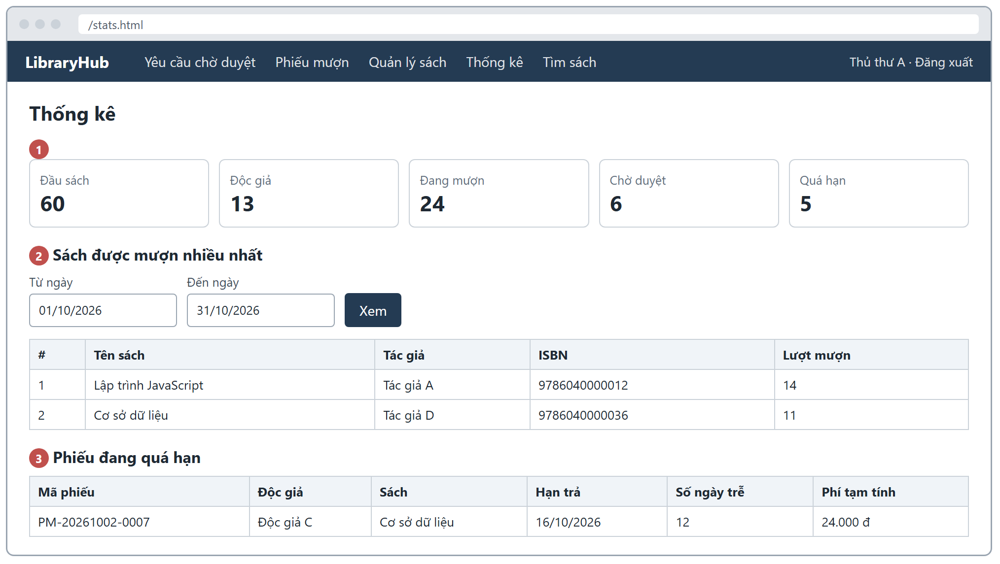

*Hình 2-17: Giao diện màn hình SCR-10 – Thống kê*

### 2.7 Bảng mã lỗi

Mọi lỗi trả về dạng `{ "error": "<MÃ_L``Ỗ``I_API>", "message": "<thông báo>", "fields": {…} }` (`fields` chỉ có ở lỗi 400). Giao diện hiển thị đúng thông báo ở cột phải.

| Mã lỗi | Trường hợp phát sinh | Thông báo hiển thị cho người dùng |
|---|---|---|
| ERR-01 400 VALIDATION_ERROR | Dữ liệu đầu vào vi phạm VAL-xx, thiếu trường bắt buộc, sai kiểu, hoặc thân yêu cầu không phải JSON hợp lệ. | "Dữ liệu gửi lên không hợp lệ" kèm thông báo từng trường theo Bảng 4-5; JSON hỏng: "Dữ liệu JSON không hợp lệ." |
| ERR-02 409 EMAIL_EXISTS | Đăng ký bằng email đã tồn tại (không phân biệt hoa thường). | MSG-02: Email đã được sử dụng. |
| ERR-03 404 NOT_FOUND | Sách, phiếu hoặc tài khoản không tồn tại/đã xoá/không thuộc người gọi; id không phải số nguyên dương; đường dẫn API không tồn tại. | Không tìm thấy sách. / Không tìm thấy phiếu mượn. / Không tìm thấy tài khoản. / Không tìm thấy API. |
| ERR-04 409 LOAN_LIMIT_REACHED | Độc giả đã có 5 phiếu chưa kết thúc (BUS-01). | MSG-05: Bạn đã mượn tối đa 5 cuốn. Vui lòng trả bớt sách trước khi mượn thêm. |
| ERR-05 409 HAS_OVERDUE_LOAN | Độc giả có phiếu quá hạn (BUS-05). | MSG-06: Bạn đang có sách quá hạn. Vui lòng trả sách trước khi mượn thêm. |
| ERR-06 409 DUPLICATE_LOAN | Đã có phiếu chưa kết thúc cho cùng đầu sách (BUS-07). | MSG-07: Bạn đã có yêu cầu hoặc đang mượn cuốn sách này. |
| ERR-07 409 OUT_OF_STOCK | availableCopies = 0 khi gửi yêu cầu hoặc khi duyệt (BUS-06). | Gửi yêu cầu – MSG-08: Sách đã hết, vui lòng quay lại sau. / Duyệt: Sách đã hết, không thể duyệt. |
| ERR-08 409 INVALID_STATUS | Chuyển trạng thái không hợp lệ (mục 2.5.4). | Chỉ duyệt được phiếu đang chờ duyệt. / Chỉ từ chối được phiếu đang chờ duyệt. / Chỉ xác nhận trả được phiếu đang mượn hoặc quá hạn. / Chỉ gia hạn được phiếu đang mượn và chưa quá hạn. |
| ERR-09 401 UNAUTHORIZED | Thiếu token, token sai, hết hạn hoặc đã đăng xuất. | MSG-15: Phiên đăng nhập đã hết hạn. Vui lòng đăng nhập lại. |
| ERR-10 409 RENEW_LIMIT_REACHED | Gia hạn phiếu đã gia hạn 1 lần (BUS-03). | MSG-11: Mỗi phiếu chỉ được gia hạn 1 lần. |
| ERR-11 409 ISBN_EXISTS | ISBN trùng khi thêm hoặc sửa đầu sách. | MSG-13: ISBN đã tồn tại. |
| ERR-12 409 COPIES_IN_USE | totalCopies mới nhỏ hơn số bản đang cho mượn n (BUS-12). | Số bản không được nhỏ hơn số bản đang cho mượn (n). |
| ERR-13 409 BOOK_IN_USE | Xoá đầu sách còn phiếu chưa kết thúc (BUS-11). | MSG-14: Không thể xoá sách đang được mượn hoặc chờ duyệt. |
| ERR-14 401 INVALID_CREDENTIALS | Sai email hoặc mật khẩu khi đăng nhập. | MSG-03: Email hoặc mật khẩu không đúng. |
| ERR-15 403 ACCOUNT_LOCKED | Tài khoản LOCKED đăng nhập hoặc gọi API cần đăng nhập (BUS-10). | MSG-04: Tài khoản đã bị khoá. Vui lòng liên hệ thư viện. |
| ERR-16 403 FORBIDDEN | Gọi chức năng không thuộc vai trò (Bảng 2-2). | Bạn không có quyền thực hiện thao tác này. |
| ERR-17 409 SELF_MODIFICATION | Quản trị viên tự khoá hoặc tự đổi vai trò của chính mình (BUS-13). | Bạn không thể khoá tài khoản của chính mình. / Bạn không thể đổi vai trò của chính mình. |

*Bảng 2-29: Bảng mã lỗi*

Lỗi không lường trước: 500 INTERNAL_ERROR "Lỗi máy chủ. Vui lòng thử lại sau.", không kèm stack trace (NFR-12).

### 2.8 Ma trận truy vết yêu cầu

| Mã URD | Mã yêu cầu SRS | Màn hình | Gợi ý điểm kiểm thử |
|---|---|---|---|
| US-01 | FR-01, UC-01, VAL-01→05, ERR-01, ERR-02 | SCR-02 | Giá trị biên độ dài họ tên/mật khẩu; email trùng khác hoa thường; nhiều lỗi cùng lúc. |
| US-02 | FR-02, UC-02, BUS-10, ERR-09, 14, 15 | SCR-01 | Sai mật khẩu; tài khoản khoá; kiểu dữ liệu đầu vào; token sau đăng xuất; điều hướng theo vai trò. |
| US-03 | FR-03, UC-03, VAL-15, 16, DIS-05 | SCR-03 | Khớp một phần, không phân biệt hoa thường; kết hợp bộ lọc; số liệu phân trang; MSG-12. |
| US-04 | FR-04, UC-04, BUS-11, DIS-09 | SCR-04 | "Còn X/Y bản", trạng thái hết sách; id không hợp lệ hoặc đã xoá. |
| US-05 | FR-05, UC-05, BUS-01, 05, 06, 07; Bảng 4-2 | SCR-04 | Từng cột của bảng quyết định; thứ tự kiểm tra; số bản không đổi khi gửi. |
| US-06 | FR-06, UC-06, BUS-04, 09; DIS-02→04 | SCR-05 | Chỉ thấy phiếu của mình; phí tạm tính; định dạng ngày, tiền, nhãn trạng thái. |
| US-07 | FR-07, UC-07, BUS-03; Bảng 4-3 | SCR-05 | Hạn trả mới; gia hạn lần 2; phiếu quá hạn. |
| US-08 | FR-08, UC-08, BUS-02, 06, 08; VAL-20 | SCR-06 | Hạn trả sau duyệt; số bản sau duyệt/từ chối; độ dài lý do; duyệt đồng thời bản cuối. |
| US-09 | FR-09, UC-09, BUS-04, 08; Bảng 4-4 | SCR-07 | Phí ở các mốc 0, 1, 49, 50, 51 ngày; số bản sau trả; trạng thái không hợp lệ. |
| US-10 | FR-10, UC-10, BUS-11, 12; VAL-10→14 | SCR-08 | ISBN trùng; giảm số bản; xoá sách đang mượn; hiệu lực ngay trong tìm kiếm. |
| US-11 | FR-11, UC-11, BUS-10, 13 | SCR-09 | Khoá có hiệu lực ngay; tự khoá/tự đổi vai trò; giá trị vai trò không hợp lệ. |
| US-12 | FR-12, UC-12, VAL-21 | SCR-10 | Khoảng thời gian biên 366 ngày; ngày không có thật; thứ tự sách mượn nhiều. |
| UQ-01, 02 | NFR-01 → NFR-05 | SCR-03, 04 | Kịch bản JMeter theo mục 3.2. |
| UQ-03, 04 | NFR-09, 10, 11; DIS-01→10 | Tất cả | Kiểm tra ở 360, 375, 768, 1366, 1920 px; 3 trình duyệt; chính tả. |
| UQ-05 | NFR-06, NFR-07 | Tất cả | Ma trận phân quyền Bảng 2-2; phản hồi không chứa mật khẩu. |
| UQ-06 | NFR-08, NFR-12, NFR-13 | – | Giám sát `/api/health`; dữ liệu bất thường; đối chiếu số bản. |

*Bảng 2-30: Ma trận truy vết yêu cầu*

### 2.9 Câu hỏi gửi bộ phận nghiệp vụ

| TT | Câu hỏi | Người trả lời | Câu trả lời – ngày |
|---|---|---|---|
| 1 | Giới hạn 5 cuốn có tính cả các yêu cầu đang chờ duyệt không? | Chủ hệ thống (Mỵ Hiểu Minh) | Có, tính cả PENDING (BUS-01). – 02/10/2026 |
| 2 | "Ngày" trong thời hạn mượn và phí phạt là ngày lịch hay ngày làm việc? | Chủ hệ thống (Mỵ Hiểu Minh) | Ngày lịch theo giờ Việt Nam. – 02/10/2026 |
| 3 | Hạn trả tính từ ngày gửi yêu cầu hay ngày duyệt? | Chủ hệ thống (Mỵ Hiểu Minh) | Từ ngày thủ thư duyệt (BUS-02). – 02/10/2026 |
| 4 | Phiếu đã quá hạn có được gia hạn không? | Chủ hệ thống (Mỵ Hiểu Minh) | Không (BUS-03). – 02/10/2026 |
| 5 | Xoá đầu sách có xoá lịch sử phiếu mượn liên quan không? | Chủ hệ thống (Mỵ Hiểu Minh) | Không; xoá mềm, phiếu cũ giữ tên sách (BUS-11). – 02/10/2026 |
| 6 | Thủ thư/quản trị viên có được mượn sách không? | Chủ hệ thống (Mỵ Hiểu Minh) | Không; chỉ vai trò Độc giả được mượn. – 02/10/2026 |

*Bảng 2-31: Câu hỏi gửi bộ phận nghiệp vụ*

## 3 Các yêu cầu phi chức năng

### 3.1 Giao diện người dùng

| Mã | Nội dung yêu cầu |
|---|---|
| DIS-01 | Toàn bộ giao diện tiếng Việt có dấu, đúng chính tả (NFR-11). |
| DIS-02 | Số tiền hiển thị dạng **"2.000 đ"**: dấu chấm phân cách hàng nghìn, một khoảng trắng, ký hiệu "đ". |
| DIS-03 | Ngày hiển thị dạng **dd/mm/yyyy** theo giờ Việt Nam; ngày giờ dạng dd/mm/yyyy HH:mm. |
| DIS-04 | Nhãn trạng thái phiếu: PENDING – "Chờ duyệt"; BORROWING – "Đang mượn"; OVERDUE – "Quá hạn"; RETURNED – "Đã trả"; REJECTED – "Bị từ chối". |
| DIS-05 | Số mục mỗi trang: Tìm sách 12; Lịch sử mượn 10; Yêu cầu chờ duyệt, Quản lý phiếu mượn, Quản lý sách, Quản trị tài khoản 20. Điều hướng trang hiển thị "Trang a/b". |
| DIS-06 | Lỗi nhập liệu hiển thị ngay dưới ô tương ứng; thông báo thành công/thất bại hiển thị ở đầu vùng nội dung hoặc trong hộp thoại. |
| DIS-07 | Thao tác không hoàn tác được (xoá sách, xác nhận trả, từ chối) phải có hộp thoại xác nhận. |
| DIS-08 | Hiển thị đúng ở chiều rộng 360 px – 1920 px, không có thanh cuộn ngang toàn trang; bảng dài được cuộn trong vùng bảng (NFR-09). |
| DIS-09 | Thẻ/trang sách hiển thị "Còn X/Y bản"; X = 0 hiển thị "Hết sách". Nút theo vai trò: "Gửi yêu cầu mượn" (Độc giả), "Đăng nhập để mượn" (Khách). |
| DIS-10 | Đầu sách không có ảnh bìa dùng ảnh bìa mặc định; mật khẩu nhập ở dạng ẩn. |

*Bảng 3-1: Yêu cầu giao diện người dùng*

### 3.2 Hiệu năng

**Môi trường đo:** máy chủ triển khai chính thức, dữ liệu mẫu (60 đầu sách, 17 tài khoản, 113 phiếu), JMeter chạy từ một máy khách, think time 0–1 giây.

| Mã | Nội dung yêu cầu |
|---|---|
| NFR-01 | `GET /api/books` có từ khoá: **p95 ≤ 1.000 ms** với **50 người dùng đồng thời** trong 5 phút; throughput **≥ 20 yêu cầu/giây**. Đo: JMeter Aggregate Report. |
| NFR-02 | `POST /api/auth/login`, `GET /api/books/{id}`, `GET /api/loans/me`: **thời gian phản hồi trung bình ≤ 500 ms** với **20 người dùng đồng thời**, đánh giá riêng từng endpoint. |
| NFR-03 | `POST /api/loans` và `POST /api/librarian/loans/{id}/approve`: **p95 ≤ 1.500 ms**, **tỉ lệ lỗi < 1%** với **30 người dùng đồng thời**. |
| NFR-04 | Tăng tải từ 10 lên **100 người dùng** trong 10 phút (bậc 10, 20, 40, 60, 100; mỗi bậc 2 phút): tỉ lệ lỗi 5xx/timeout **≤ 5%**, máy chủ không dừng. |
| NFR-05 | Trang Tìm sách và Chi tiết sách tải xong (sự kiện load) **≤ 3 giây** ở mạng 10 Mbps, cache lạnh; tổng dung lượng trang **≤ 2 MB** (HTML, CSS, JS, ảnh, API). Mỗi trang đo 5 lần. |

*Bảng 3-2: Yêu cầu hiệu năng*

**Quy trình đo và lưu bằng chứng:**

- Ghi trước khi đo: URL, mã commit triển khai, thời điểm (UTC+7), CPU/RAM máy chủ, hệ điều hành, phiên bản Node.js/PostgreSQL, cấu hình máy tạo tải và mạng.
- NFR-01 → NFR-03: ramp-up 60 giây rồi đo 5 phút ở đúng số người dùng quy định; giai đoạn ramp-up ghi riêng, không tính vào cửa sổ đo.
- NFR-03 dùng tài khoản và đầu sách riêng cho tải thử; thiết kế chu trình mượn – duyệt – trả để không hết sách hoặc chạm giới hạn 5 phiếu; tách lỗi nghiệp vụ do dữ liệu thử khỏi lỗi kỹ thuật theo tiêu chí xác định trước, vẫn lưu kết quả gốc.
- Lưu .jmx, .jtl, HTML dashboard, ảnh chụp và bảng Đạt/Không đạt cho từng NFR. Ngưỡng trong SRS không phải kết quả đo.

### 3.3 Tính bảo mật

| Mã | Nội dung yêu cầu |
|---|---|
| NFR-06 | Mật khẩu băm bằng bcrypt, cost **≥ 10**; không API nào trả mật khẩu hay mã băm. Đo: kiểm tra phản hồi. |
| NFR-07 | Token hết hạn sau **60 phút**; API cần đăng nhập trả **401** khi thiếu/sai/hết hạn/đã thu hồi token và **403** khi sai vai trò (Bảng 2-2). Đo: Postman. |
| BUS-10 | Tài khoản LOCKED bị chặn ở mọi API cần đăng nhập (403 ACCOUNT_LOCKED) ngay ở lần gọi kế tiếp. |
| – | Người dùng chỉ đọc/sửa được dữ liệu của mình theo ma trận phân quyền; phiếu của người khác trả 404 để không lộ sự tồn tại. |
| – | Thông tin kết nối cơ sở dữ liệu và khoá ký token đặt trong biến môi trường, không nằm trong mã nguồn hay tài liệu. |

*Bảng 3-3: Yêu cầu bảo mật*

### 3.4 Ràng buộc

| Mã | Nội dung yêu cầu |
|---|---|
| NFR-08 | Sẵn sàng **≥ 99%** thời gian từ tuần 6 đến tuần 14; mỗi lần gián đoạn **≤ 4 giờ**. Giám sát HTTP `GET /api/health` mỗi 60 giây; thành công khi HTTP 2xx trong 10 giây. |
| NFR-09 | Hiển thị đúng ở chiều rộng **360 px – 1920 px**, không có thanh cuộn ngang; kiểm tra ở 360, 375, 768, 1366, 1920 px. |
| NFR-10 | Chạy đúng trên **Chrome, Edge, Firefox** – 2 phiên bản mới nhất. |
| NFR-11 | Nội dung theo DIS-01 → DIS-04. |
| NFR-12 | Dữ liệu sai kiểu hoặc ngày không tồn tại là lỗi đầu vào (400). Lỗi không lường trước còn lại trả **500** INTERNAL_ERROR, **không lộ stack trace**; máy chủ tiếp tục phục vụ. |
| NFR-13 | availableCopies luôn trong **0 – totalCopies**; số bản đang cho mượn luôn bằng số phiếu BORROWING + OVERDUE của đầu sách. |
| Kỹ thuật | Node.js + Express, PostgreSQL, giao diện HTML/JS; API JSON tại `/api`; ngày giờ lưu ISO 8601, hiển thị UTC+7. Phiên bản bàn giao tuần 6 không thay đổi đến tuần 14. |

*Bảng 3-4: Các ràng buộc*

## 4 Phụ lục

### 4.1 Quy tắc nghiệp vụ (BUS)

| Mã | Quy tắc |
|---|---|
| BUS-01 | **Giới hạn mượn:** tổng số phiếu PENDING, BORROWING, OVERDUE của một độc giả không vượt quá **5**; yêu cầu mới chỉ được tạo khi tổng hiện tại ≤ 4. |
| BUS-02 | **Thời hạn mượn:** dueDate = ngày duyệt (giờ VN) + **14 ngày**. |
| BUS-03 | **Gia hạn:** chỉ phiếu BORROWING có renewCount = 0; dueDate mới = dueDate hiện tại + **7 ngày**; renewCount = 1. Phiếu OVERDUE không được gia hạn. |
| BUS-04 | **Phí phạt:** overdueDays = số ngày lịch từ dueDate đến ngày trả (hoặc hôm nay nếu chưa trả), giờ VN; trả đúng/trước hạn → 0. fine = overdueDays × **2.000 đ**, tối đa **100.000 đ**/phiếu. Áp dụng cho cả phí tạm tính. |
| BUS-05 | **Chặn khi quá hạn:** độc giả có ít nhất một phiếu OVERDUE không được tạo yêu cầu mới. |
| BUS-06 | **Còn bản:** chỉ tạo yêu cầu khi availableCopies > 0; khi duyệt kiểm tra lại availableCopies > 0. |
| BUS-07 | **Không trùng:** không tạo yêu cầu cho đầu sách mà độc giả đang có phiếu PENDING/BORROWING/OVERDUE. |
| BUS-08 | **Tồn kho:** availableCopies giảm 1 khi duyệt, tăng 1 khi xác nhận trả. Gửi yêu cầu và từ chối không làm đổi availableCopies. |
| BUS-09 | **Quá hạn tự động:** phiếu BORROWING có dueDate < hôm nay (giờ VN) chuyển OVERDUE; cập nhật trước khi trả dữ liệu phiếu, thống kê và trước khi kiểm tra BUS-05. |
| BUS-10 | **Khoá tài khoản:** tài khoản LOCKED không đăng nhập được; mọi API cần đăng nhập gọi bằng token của tài khoản đó trả 403 ACCOUNT_LOCKED. |
| BUS-11 | **Xoá đầu sách:** không xoá được đầu sách còn phiếu PENDING/BORROWING/OVERDUE; đầu sách đã xoá không còn trong tìm kiếm và chi tiết (404); phiếu cũ giữ tên sách. |
| BUS-12 | **Giảm số bản:** totalCopies mới ≥ số bản đang cho mượn (totalCopies cũ − availableCopies); availableCopies được tính lại tương ứng. |
| BUS-13 | **Tự quản trị:** quản trị viên không được khoá hay đổi vai trò tài khoản của chính mình. |

*Bảng 4-1: Quy tắc nghiệp vụ*

**Bảng quyết định – Gửi yêu cầu mượn (UC-05).** Kiểm tra theo thứ tự C1 → C4; gặp điều kiện không đạt đầu tiên thì dừng.

| Điều kiện / Hành động | R1 | R2 | R3 | R4 | R5 |
|---|---|---|---|---|---|
| C1. Đang giữ đủ 5 cuốn (BUS-01)? | Y | N | N | N | N |
| C2. Có phiếu quá hạn (BUS-05)? | – | Y | N | N | N |
| C3. Đã có phiếu chưa kết thúc cho đầu sách này (BUS-07)? | – | – | Y | N | N |
| C4. Đầu sách còn bản (BUS-06)? | – | – | – | N | Y |
| Kết quả | ERR-04 | ERR-05 | ERR-06 | ERR-07 | 201 PENDING |

*Bảng 4-2: Bảng quyết định gửi yêu cầu mượn*

**Bảng quyết định – Gia hạn (UC-07).**

| Điều kiện | R1 | R2 | R3 | R4 |
|---|---|---|---|---|
| Phiếu thuộc người gọi? | N | Y | Y | Y |
| Trạng thái BORROWING? | – | N | Y | Y |
| renewCount = 0? | – | – | N | Y |
| Kết quả | 404 (ERR-03) | 409 (ERR-08) | 409 (ERR-10) | 200, dueDate + 7 ngày |

*Bảng 4-3: Bảng quyết định gia hạn*

**Bảng giá trị phí phạt (BUS-04).**

| Trả so với hạn | overdueDays | fine |
|---|---|---|
| Trước hạn 1 ngày | 0 | 0 đ |
| Đúng ngày hạn | 0 | 0 đ |
| Trễ 1 ngày | 1 | 2.000 đ |
| Trễ 49 ngày | 49 | 98.000 đ |
| Trễ 50 ngày | 50 | 100.000 đ |
| Trễ 51 ngày | 51 | 100.000 đ |

*Bảng 4-4: Bảng giá trị phí phạt*

### 4.2 Quy tắc kiểm tra dữ liệu (VAL)

| Mã | Trường | Quy tắc | Thông báo lỗi |
|---|---|---|---|
| VAL-01 | Họ tên | 2–50 ký tự sau khi cắt khoảng trắng hai đầu; chỉ chữ cái (kể cả tiếng Việt) và khoảng trắng | Họ tên từ 2 đến 50 ký tự, chỉ gồm chữ cái |
| VAL-02 | Email | Đúng định dạng email, tối đa 100 ký tự | Email không hợp lệ |
| VAL-03 | Số điện thoại | Đúng 10 chữ số, bắt đầu bằng 0 | Số điện thoại gồm 10 chữ số, bắt đầu bằng 0 |
| VAL-04 | Mật khẩu | 8–32 ký tự, có ít nhất 1 chữ cái và 1 chữ số | Mật khẩu 8–32 ký tự, gồm cả chữ và số |
| VAL-05 | Xác nhận mật khẩu | Trùng với mật khẩu | Mật khẩu xác nhận không khớp |
| VAL-10 | ISBN | Đúng 13 chữ số | ISBN gồm đúng 13 chữ số |
| VAL-11 | Tên sách | 1–200 ký tự | Tên sách từ 1 đến 200 ký tự |
| VAL-12 | Tác giả | 1–100 ký tự | Tác giả từ 1 đến 100 ký tự |
| VAL-13 | Năm xuất bản | Số nguyên 1900 – năm hiện tại | Năm xuất bản từ 1900 đến năm hiện tại |
| VAL-14 | Số bản | Số nguyên 1–100 | Số bản từ 1 đến 100 |
| VAL-15 | Từ khoá tìm kiếm | 0–100 ký tự | Từ khoá tối đa 100 ký tự |
| VAL-16 | Phân trang | page ≥ 1 (mặc định 1); size 1–50 (mặc định 10) | Tham số phân trang không hợp lệ |
| VAL-20 | Lý do từ chối | 5–200 ký tự | Lý do từ chối từ 5 đến 200 ký tự |
| VAL-21 | Khoảng thống kê | YYYY-MM-DD là ngày có thật; from ≤ to; cách nhau tối đa 366 ngày; mặc định 30 ngày gần nhất | Khoảng thời gian không hợp lệ |

*Bảng 4-5: Quy tắc kiểm tra dữ liệu*

Thông báo trường khác: thể loại "Thể loại không hợp lệ"; nhà xuất bản "Nhà xuất bản tối đa 100 ký tự"; mô tả "Mô tả tối đa 2000 ký tự"; ảnh bìa "Ảnh bìa phải là URL http/https, tối đa 500 ký tự"; bookId "Mã sách không hợp lệ"; trạng thái "Trạng thái không hợp lệ"; available "Giá trị available là true hoặc false"; sort "Giá trị sort là title hoặc newest"; trạng thái tài khoản "Trạng thái là ACTIVE hoặc LOCKED"; vai trò "Vai trò là READER, LIBRARIAN hoặc ADMIN"; đăng nhập "Vui lòng nhập email", "Vui lòng nhập mật khẩu".

### 4.3 Thông báo hệ thống (MSG)

| Mã | Nội dung |
|---|---|
| MSG-01 | Đăng ký thành công. Vui lòng đăng nhập. |
| MSG-02 | Email đã được sử dụng. |
| MSG-03 | Email hoặc mật khẩu không đúng. |
| MSG-04 | Tài khoản đã bị khoá. Vui lòng liên hệ thư viện. |
| MSG-05 | Bạn đã mượn tối đa 5 cuốn. Vui lòng trả bớt sách trước khi mượn thêm. |
| MSG-06 | Bạn đang có sách quá hạn. Vui lòng trả sách trước khi mượn thêm. |
| MSG-07 | Bạn đã có yêu cầu hoặc đang mượn cuốn sách này. |
| MSG-08 | Sách đã hết, vui lòng quay lại sau. |
| MSG-09 | Gửi yêu cầu mượn thành công. Vui lòng chờ thủ thư duyệt. |
| MSG-10 | Gia hạn thành công. Hạn trả mới: dd/mm/yyyy. |
| MSG-11 | Mỗi phiếu chỉ được gia hạn 1 lần. |
| MSG-12 | Không tìm thấy sách phù hợp. |
| MSG-13 | ISBN đã tồn tại. |
| MSG-14 | Không thể xoá sách đang được mượn hoặc chờ duyệt. |
| MSG-15 | Phiên đăng nhập đã hết hạn. Vui lòng đăng nhập lại. |
| MSG-16 | Đã xác nhận trả sách. Phí phạt: X đ. |

*Bảng 4-6: Thông báo hệ thống*

### 4.4 Mô hình dữ liệu

| Thực thể | Trường | Kiểu | Ràng buộc |
|---|---|---|---|
| User | id | integer | Tự tăng |
|  | fullName / email / phone | string | VAL-01 / VAL-02, duy nhất không phân biệt hoa thường / VAL-03 |
|  | password | string | VAL-04; chỉ lưu dạng băm (NFR-06) |
|  | role / status | enum | READER, LIBRARIAN, ADMIN / ACTIVE, LOCKED |
| Book | id | integer | Tự tăng |
|  | isbn / title / author | string | VAL-10, duy nhất / VAL-11 / VAL-12 |
|  | category | enum | Một trong 8 thể loại (Bảng 4-8) |
|  | publisher / publishYear | string / integer | ≤ 100 ký tự / VAL-13 |
|  | totalCopies / availableCopies | integer | VAL-14 / 0 ≤ availableCopies ≤ totalCopies, hệ thống tính |
|  | description / coverUrl | string | ≤ 2000 ký tự / URL http/https ≤ 500 ký tự |
| Loan | id / code | integer / string | Tự tăng / PM-YYYYMMDD-NNNN, NNNN đánh số trong ngày từ 0001 |
|  | userId, bookId | integer | Khoá ngoại |
|  | status | enum | PENDING, BORROWING, OVERDUE, RETURNED, REJECTED |
|  | requestedAt / approvedAt / returnedAt | datetime | Lúc gửi / duyệt / xác nhận trả |
|  | dueDate | date | BUS-02, BUS-03 |
|  | renewCount / overdueDays / fine | integer | 0 hoặc 1 / ≥ 0 / VND ≥ 0 (BUS-04) |
|  | rejectReason | string | VAL-20 |

*Bảng 4-7: Mô hình dữ liệu*

| TT | Thể loại |
|---|---|
| 1 | Công nghệ thông tin |
| 2 | Kinh tế |
| 3 | Ngoại ngữ |
| 4 | Văn học |
| 5 | Khoa học tự nhiên |
| 6 | Kỹ năng |
| 7 | Tiếng Nhật |
| 8 | Khác |

*Bảng 4-8: Danh mục thể loại*

### 4.5 Định dạng API chung

- Thành công: `{ "data": … }`; danh sách kèm `"pagination": { page, size, totalItems, totalPages }`.
- Lỗi: `{ "error": "<MÃ_L``Ỗ``I_API>", "message": "<thông báo ti``ế``ng Vi``ệ``t>", "fields": { … } }`; `fields` chỉ có khi 400.
- Xác thực: header `Authorization: Bearer <token>`; `GET /api/health` trả `{ "data": { "status": "ok" } }` cho giám sát.
- Chi tiết từng endpoint, ví dụ yêu cầu và phản hồi: Tài liệu API LibraryHub.
