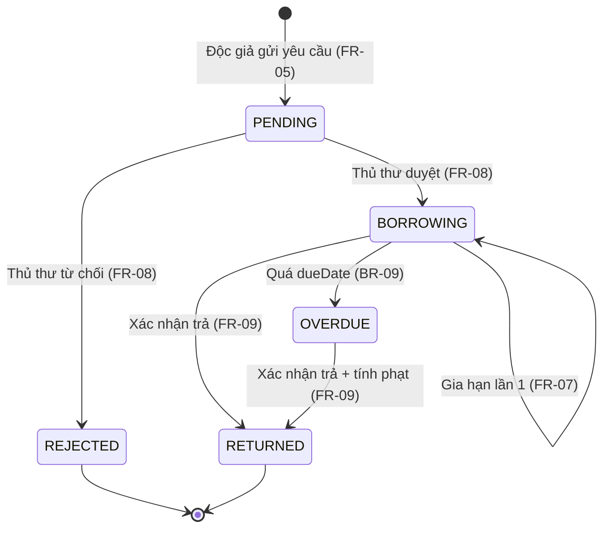

# ĐẶC TẢ YÊU CẦU PHẦN MỀM (SRS)

**Hệ thống:** Quản lý mượn – trả sách thư viện (LibraryHub)
**Phiên bản:** 1.0 · **Người lập:** Mỵ Hiểu Minh – 23110198 · **Ngày:** 02/10/2026
**Tài liệu liên quan:** URD v1.0, Tài liệu API v1.0

---

## 1. Giới thiệu

### 1.1. Mục đích
Đặc tả đầy đủ, kiểm chứng được các yêu cầu chức năng và phi chức năng của hệ thống LibraryHub. Mỗi yêu cầu có mã duy nhất để truy vết từ URD và để thiết kế test case.

### 1.2. Quy ước mã
| Tiền tố | Ý nghĩa |
|---|---|
| FR-xx | Yêu cầu chức năng |
| NFR-xx | Yêu cầu phi chức năng |
| BR-xx | Quy tắc nghiệp vụ |
| FLOW-xx | Luồng nghiệp vụ |
| VR-xx | Quy tắc kiểm tra dữ liệu (validation) |
| MSG-xx | Thông báo hiển thị |

### 1.3. Tổng quan hệ thống
- Ứng dụng web gồm giao diện (HTML/JS) và API REST trả JSON tại `/api`.
- Xác thực bằng JWT Bearer, hạn 60 phút.
- Ngày giờ lưu theo ISO 8601, hiển thị theo múi giờ Asia/Ho_Chi_Minh (UTC+7).

---

## 2. Vai trò người dùng

| Mã | Vai trò | Mã trong hệ thống | Mô tả |
|---|---|---|---|
| R-00 | Khách | (không đăng nhập) | Xem trang chủ, tìm và xem sách, đăng ký |
| R-01 | Độc giả | `READER` | Mượn, gia hạn, xem lịch sử mượn của mình |
| R-02 | Thủ thư | `LIBRARIAN` | Duyệt/từ chối, xác nhận trả, quản lý đầu sách, thống kê |
| R-03 | Quản trị viên | `ADMIN` | Quản lý tài khoản, thống kê |

### 2.1. Ma trận phân quyền

✔ = được phép · ✘ = bị chặn (API trả 401 nếu chưa đăng nhập, 403 nếu sai vai trò) · ◐ = chỉ dữ liệu của chính mình

| Chức năng | Khách | Độc giả | Thủ thư | Quản trị viên |
|---|:-:|:-:|:-:|:-:|
| FR-01 Đăng ký | ✔ | ✘ | ✘ | ✘ |
| FR-02 Đăng nhập / đăng xuất | ✔ | ✔ | ✔ | ✔ |
| FR-03 Tìm kiếm sách | ✔ | ✔ | ✔ | ✔ |
| FR-04 Xem chi tiết sách | ✔ | ✔ | ✔ | ✔ |
| FR-05 Gửi yêu cầu mượn | ✘ (401) | ✔ | ✘ (403) | ✘ (403) |
| FR-06 Xem lịch sử mượn | ✘ (401) | ◐ | ✘ (403) | ✘ (403) |
| FR-07 Gia hạn sách | ✘ (401) | ◐ | ✘ (403) | ✘ (403) |
| FR-08 Duyệt / từ chối yêu cầu | ✘ (401) | ✘ (403) | ✔ | ✘ (403) |
| FR-09 Xác nhận trả sách | ✘ (401) | ✘ (403) | ✔ | ✘ (403) |
| FR-10 Thêm / sửa / xoá sách | ✘ (401) | ✘ (403) | ✔ | ✘ (403) |
| FR-11 Quản lý tài khoản | ✘ (401) | ✘ (403) | ✘ (403) | ✔ |
| FR-12 Xem thống kê | ✘ (401) | ✘ (403) | ✔ | ✔ |

> Ở FR-01, người đã đăng nhập mở trang đăng ký sẽ được chuyển về trang chủ (giao diện); API đăng ký không yêu cầu token.

---

## 3. Mô hình dữ liệu

### 3.1. Người dùng (User)
| Trường | Kiểu | Ràng buộc |
|---|---|---|
| id | integer | Tự tăng |
| fullName | string | VR-01 |
| email | string | VR-02, duy nhất (không phân biệt hoa thường) |
| phone | string | VR-03 |
| password | string | VR-04, chỉ lưu dạng băm (NFR-06) |
| role | enum | `READER` / `LIBRARIAN` / `ADMIN` |
| status | enum | `ACTIVE` / `LOCKED` |
| createdAt | datetime | |

### 3.2. Đầu sách (Book)
| Trường | Kiểu | Ràng buộc |
|---|---|---|
| id | integer | Tự tăng |
| isbn | string | VR-10, duy nhất |
| title | string | VR-11 |
| author | string | VR-12 |
| category | enum | Một trong danh mục thể loại (mục 3.4) |
| publisher | string | 0–100 ký tự |
| publishYear | integer | VR-13 |
| totalCopies | integer | VR-14 |
| availableCopies | integer | 0 ≤ availableCopies ≤ totalCopies; do hệ thống tính |
| description | string | 0–2000 ký tự |
| coverUrl | string | URL http/https, tối đa 500 ký tự; trống → ảnh mặc định |
| createdAt | datetime | |

### 3.3. Phiếu mượn (Loan)
| Trường | Kiểu | Ràng buộc |
|---|---|---|
| id | integer | Tự tăng |
| code | string | Định dạng `PM-YYYYMMDD-NNNN` (NNNN là số thứ tự trong ngày, bắt đầu 0001) |
| userId, bookId | integer | Khoá ngoại |
| status | enum | `PENDING` / `BORROWING` / `OVERDUE` / `RETURNED` / `REJECTED` |
| requestedAt | datetime | Lúc gửi yêu cầu |
| approvedAt | datetime | Lúc duyệt |
| dueDate | date | Hạn trả |
| renewCount | integer | 0 hoặc 1 |
| returnedAt | datetime | Lúc xác nhận trả |
| overdueDays | integer | ≥ 0 |
| fine | integer | VND, ≥ 0 |
| rejectReason | string | VR-20 |

### 3.4. Danh mục thể loại
`Công nghệ thông tin`, `Kinh tế`, `Ngoại ngữ`, `Văn học`, `Khoa học tự nhiên`, `Kỹ năng`, `Tiếng Nhật`, `Khác`.

---

## 4. Quy tắc nghiệp vụ

| Mã | Quy tắc |
|---|---|
| BR-01 | **Giới hạn mượn:** tổng số phiếu của một độc giả ở trạng thái `PENDING`, `BORROWING`, `OVERDUE` không vượt quá **5**. Yêu cầu mới chỉ được tạo khi tổng hiện tại ≤ 4. |
| BR-02 | **Thời hạn mượn:** `dueDate` = ngày duyệt (theo giờ VN) + **14 ngày**. |
| BR-03 | **Gia hạn:** chỉ phiếu `BORROWING` có `renewCount = 0` mới được gia hạn; `dueDate` mới = `dueDate` cũ + **7 ngày**; `renewCount` = 1. Phiếu `OVERDUE` không được gia hạn. |
| BR-04 | **Phí phạt:** `overdueDays` = số ngày lịch từ `dueDate` đến ngày trả (giờ VN); nếu trả đúng hoặc trước hạn thì 0. `fine` = `overdueDays` × **2.000 đ**, tối đa **100.000 đ**/phiếu. |
| BR-05 | **Chặn khi quá hạn:** độc giả có ít nhất một phiếu `OVERDUE` thì không được tạo yêu cầu mượn mới. |
| BR-06 | **Còn bản:** chỉ tạo yêu cầu khi `availableCopies` > 0; khi duyệt phải kiểm tra lại `availableCopies` > 0. |
| BR-07 | **Không trùng:** độc giả không được tạo yêu cầu cho đầu sách mà mình đang có phiếu `PENDING`/`BORROWING`/`OVERDUE`. |
| BR-08 | **Tồn kho:** `availableCopies` giảm 1 khi duyệt, tăng 1 khi xác nhận trả. Gửi yêu cầu và từ chối không làm đổi `availableCopies`. |
| BR-09 | **Quá hạn tự động:** phiếu `BORROWING` có `dueDate` < ngày hiện tại (giờ VN) chuyển sang `OVERDUE`. Hệ thống cập nhật trước khi trả dữ liệu phiếu mượn, thống kê và trước khi kiểm tra BR-05. |
| BR-10 | **Khoá tài khoản:** tài khoản `LOCKED` không đăng nhập được; mọi API cần đăng nhập gọi bằng token của tài khoản đó trả 403 `ACCOUNT_LOCKED`. |
| BR-11 | **Xoá đầu sách:** không xoá được đầu sách đang có phiếu `PENDING`/`BORROWING`/`OVERDUE`. Đầu sách đã xoá không còn xuất hiện trong tìm kiếm và chi tiết (404); phiếu cũ vẫn giữ tên sách. |
| BR-12 | **Giảm số bản:** khi sửa `totalCopies`, giá trị mới phải ≥ số bản đang cho mượn (`totalCopies` cũ − `availableCopies`). `availableCopies` được tính lại tương ứng. |
| BR-13 | **Tự quản trị:** quản trị viên không được khoá, đổi vai trò tài khoản của chính mình. |

### 4.1. Bảng quyết định – Gửi yêu cầu mượn (FR-05)

Các điều kiện được kiểm tra theo thứ tự C1 → C4; gặp điều kiện không đạt đầu tiên thì dừng.

| | R1 | R2 | R3 | R4 | R5 |
|---|:-:|:-:|:-:|:-:|:-:|
| **C1.** Đang giữ đủ 5 cuốn (BR-01)? | Y | N | N | N | N |
| **C2.** Có phiếu quá hạn (BR-05)? | – | Y | N | N | N |
| **C3.** Đã có phiếu chưa kết thúc cho đầu sách này (BR-07)? | – | – | Y | N | N |
| **C4.** Đầu sách còn bản (BR-06)? | – | – | – | N | Y |
| **A1.** Từ chối, 409 `LOAN_LIMIT_REACHED`, MSG-05 | ✔ | | | | |
| **A2.** Từ chối, 409 `HAS_OVERDUE_LOAN`, MSG-06 | | ✔ | | | |
| **A3.** Từ chối, 409 `DUPLICATE_LOAN`, MSG-07 | | | ✔ | | |
| **A4.** Từ chối, 409 `OUT_OF_STOCK`, MSG-08 | | | | ✔ | |
| **A5.** Tạo phiếu `PENDING`, 201 | | | | | ✔ |

### 4.2. Bảng quyết định – Gia hạn (FR-07)

| | R1 | R2 | R3 | R4 |
|---|:-:|:-:|:-:|:-:|
| Phiếu thuộc người gọi? | N | Y | Y | Y |
| Trạng thái `BORROWING`? | – | N | Y | Y |
| `renewCount` = 0? | – | – | N | Y |
| Kết quả | 404 `NOT_FOUND` | 409 `INVALID_STATUS` | 409 `RENEW_LIMIT_REACHED` | 200, `dueDate` + 7 ngày |

### 4.3. Bảng giá trị phí phạt (BR-04)

| Trả so với hạn | overdueDays | fine |
|---|---|---|
| Trước hạn 1 ngày | 0 | 0 đ |
| Đúng ngày hạn | 0 | 0 đ |
| Trễ 1 ngày | 1 | 2.000 đ |
| Trễ 49 ngày | 49 | 98.000 đ |
| Trễ 50 ngày | 50 | 100.000 đ |
| Trễ 51 ngày | 51 | 100.000 đ |

---

## 5. Sơ đồ trạng thái phiếu mượn

| Từ | Sự kiện | Điều kiện | Đến | Nhãn hiển thị |
|---|---|---|---|---|
| (mới) | Gửi yêu cầu | Bảng 4.1 – R5 | `PENDING` | Chờ duyệt |
| `PENDING` | Duyệt | `availableCopies` > 0 | `BORROWING` | Đang mượn |
| `PENDING` | Từ chối | Có lý do hợp lệ | `REJECTED` | Bị từ chối |
| `BORROWING` | Gia hạn | `renewCount` = 0 | `BORROWING` | Đang mượn |
| `BORROWING` | Hết hạn | `dueDate` < hôm nay | `OVERDUE` | Quá hạn |
| `BORROWING` | Xác nhận trả | – | `RETURNED` | Đã trả |
| `OVERDUE` | Xác nhận trả | – | `RETURNED` | Đã trả |

**Chuyển trạng thái không hợp lệ** (phải trả 409 `INVALID_STATUS`): duyệt/từ chối phiếu không ở `PENDING`; xác nhận trả phiếu `PENDING`/`REJECTED`/`RETURNED`; gia hạn phiếu khác `BORROWING`.

---

## 6. Quy tắc kiểm tra dữ liệu

| Mã | Trường | Quy tắc | Thông báo lỗi |
|---|---|---|---|
| VR-01 | Họ tên | 2–50 ký tự sau khi cắt khoảng trắng hai đầu; chỉ chữ cái (kể cả tiếng Việt) và khoảng trắng | "Họ tên từ 2 đến 50 ký tự, chỉ gồm chữ cái" |
| VR-02 | Email | Đúng định dạng email, tối đa 100 ký tự | "Email không hợp lệ" |
| VR-03 | Số điện thoại | Đúng 10 chữ số, bắt đầu bằng 0 | "Số điện thoại gồm 10 chữ số, bắt đầu bằng 0" |
| VR-04 | Mật khẩu | 8–32 ký tự, có ít nhất 1 chữ cái và 1 chữ số | "Mật khẩu 8–32 ký tự, gồm cả chữ và số" |
| VR-05 | Xác nhận mật khẩu | Trùng với mật khẩu | "Mật khẩu xác nhận không khớp" |
| VR-10 | ISBN | Đúng 13 chữ số | "ISBN gồm đúng 13 chữ số" |
| VR-11 | Tên sách | 1–200 ký tự | "Tên sách từ 1 đến 200 ký tự" |
| VR-12 | Tác giả | 1–100 ký tự | "Tác giả từ 1 đến 100 ký tự" |
| VR-13 | Năm xuất bản | Số nguyên 1900 – năm hiện tại | "Năm xuất bản từ 1900 đến năm hiện tại" |
| VR-14 | Số bản | Số nguyên 1–100 | "Số bản từ 1 đến 100" |
| VR-15 | Từ khoá tìm kiếm | 0–100 ký tự; dài hơn → 400 | "Từ khoá tối đa 100 ký tự" |
| VR-16 | Phân trang | `page` ≥ 1 (mặc định 1); `size` 1–50 (mặc định 10) | "Tham số phân trang không hợp lệ" |
| VR-20 | Lý do từ chối | 5–200 ký tự | "Lý do từ chối từ 5 đến 200 ký tự" |
| VR-21 | Khoảng thống kê | `from` ≤ `to`, cách nhau tối đa 366 ngày; mặc định 30 ngày gần nhất | "Khoảng thời gian không hợp lệ" |

## 7. Thông báo hệ thống

| Mã | Nội dung |
|---|---|
| MSG-01 | Đăng ký thành công. Vui lòng đăng nhập. |
| MSG-02 | Email đã được sử dụng. |
| MSG-03 | Email hoặc mật khẩu không đúng. |
| MSG-04 | Tài khoản đã bị khoá. Vui lòng liên hệ thư viện. |
| MSG-05 | Bạn đã mượn tối đa 5 cuốn. Vui lòng trả bớt sách trước khi mượn thêm. |
| MSG-06 | Bạn đang có sách quá hạn. Vui lòng trả sách trước khi mượn thêm. |
| MSG-07 | Bạn đã có yêu cầu hoặc đang mượn cuốn sách này. |
| MSG-08 | Sách đã hết, vui lòng quay lại sau. |
| MSG-09 | Gửi yêu cầu mượn thành công. Vui lòng chờ thủ thư duyệt. |
| MSG-10 | Gia hạn thành công. Hạn trả mới: dd/mm/yyyy. |
| MSG-11 | Mỗi phiếu chỉ được gia hạn 1 lần. |
| MSG-12 | Không tìm thấy sách phù hợp. |
| MSG-13 | ISBN đã tồn tại. |
| MSG-14 | Không thể xoá sách đang được mượn hoặc chờ duyệt. |
| MSG-15 | Phiên đăng nhập đã hết hạn. Vui lòng đăng nhập lại. |
| MSG-16 | Đã xác nhận trả sách. Phí phạt: X đ. |

---

## 8. Yêu cầu chức năng

Mỗi chức năng ghi: mô tả, vai trò, đầu vào, xử lý, đầu ra, ngoại lệ, API.

### FR-01. Đăng ký tài khoản
- **Vai trò:** Khách. **Nguồn:** US-01.
- **Đầu vào:** fullName (VR-01), email (VR-02), phone (VR-03), password (VR-04), confirmPassword (VR-05).
- **Xử lý:**
  1. Kiểm tra từng trường; nếu có lỗi, trả **tất cả** lỗi trong `fields`.
  2. Chuẩn hoá email về chữ thường, kiểm tra trùng.
  3. Băm mật khẩu, tạo tài khoản `role = READER`, `status = ACTIVE`.
- **Đầu ra:** 201, thông tin tài khoản (không có mật khẩu); giao diện hiện MSG-01 và chuyển tới trang đăng nhập.
- **Ngoại lệ:** dữ liệu sai → 400 `VALIDATION_ERROR`; email trùng → 409 `EMAIL_EXISTS` (MSG-02).
- **API:** `POST /api/auth/register`.

### FR-02. Đăng nhập / đăng xuất
- **Vai trò:** Tất cả. **Nguồn:** US-02.
- **Đầu vào:** email, password.
- **Xử lý:** so khớp email (không phân biệt hoa thường) và mật khẩu; kiểm tra BR-10; cấp JWT hạn 60 phút chứa `id`, `role`.
- **Đầu ra:** 200, `token`, `expiresIn` = 3600, thông tin người dùng. Giao diện chuyển trang theo vai trò: Độc giả → `/`, Thủ thư → `/librarian`, Quản trị viên → `/admin`.
- **Đăng xuất:** `POST /api/auth/logout` thu hồi token hiện tại; mọi lần gọi sau bằng token đó trả 401. Giao diện xoá token và về trang đăng nhập.
- **Thông tin phiên:** `GET /api/auth/me` trả thông tin người dùng hiện tại.
- **Ngoại lệ:** sai thông tin → 401 `INVALID_CREDENTIALS` (MSG-03); tài khoản khoá → 403 `ACCOUNT_LOCKED` (MSG-04); token hết hạn/không hợp lệ → 401 `UNAUTHORIZED` (MSG-15).

### FR-03. Tìm kiếm sách
- **Vai trò:** Tất cả. **Nguồn:** US-03.
- **Đầu vào (query):** `q` (VR-15), `category`, `available` (`true` → chỉ sách còn bản), `sort` (`title` A→Z | `newest` theo `createdAt` giảm dần, mặc định `newest`), `page`, `size` (VR-16).
- **Xử lý:** `q` khớp **một phần**, không phân biệt hoa thường, trên tên sách, tác giả hoặc ISBN. Bỏ qua đầu sách đã xoá.
- **Đầu ra:** 200, danh sách (id, isbn, title, author, category, coverUrl, availableCopies, totalCopies) và `pagination` {page, size, totalItems, totalPages}. Không có kết quả → danh sách rỗng, giao diện hiện MSG-12.
- **Ngoại lệ:** tham số sai → 400 `VALIDATION_ERROR`.
- **API:** `GET /api/books`, `GET /api/categories`.

### FR-04. Xem chi tiết sách
- **Vai trò:** Tất cả. **Nguồn:** US-04.
- **Đầu ra:** 200, toàn bộ trường của đầu sách. Giao diện hiển thị "Còn X/Y bản"; nếu X = 0 hiển thị nhãn "Hết sách" và vô hiệu nút **Mượn sách**. Khách thấy nút **Đăng nhập để mượn**.
- **Ngoại lệ:** id không tồn tại, đã xoá hoặc không phải số nguyên dương → 404 `NOT_FOUND`.
- **API:** `GET /api/books/{id}`.

### FR-05. Gửi yêu cầu mượn
- **Vai trò:** Độc giả. **Nguồn:** US-05.
- **Đầu vào:** bookId.
- **Xử lý:** áp dụng BR-09, sau đó bảng quyết định 4.1. Nếu đạt: tạo phiếu `PENDING`, sinh `code`, `requestedAt` = hiện tại.
- **Đầu ra:** 201, phiếu mượn; giao diện hiện MSG-09.
- **Ngoại lệ:** bookId không tồn tại → 404; vi phạm quy tắc → 409 theo bảng 4.1.
- **API:** `POST /api/loans`.

### FR-06. Xem lịch sử mượn
- **Vai trò:** Độc giả (chỉ phiếu của mình). **Nguồn:** US-06.
- **Đầu vào:** `status` (tuỳ chọn), `page`, `size`.
- **Xử lý:** áp dụng BR-09; sắp xếp `requestedAt` giảm dần.
- **Đầu ra:** danh sách phiếu gồm code, tên sách, requestedAt, approvedAt, dueDate, returnedAt, status, renewCount, overdueDays, fine, rejectReason. Với phiếu `OVERDUE`, `fine` là phí **tạm tính** đến hôm nay theo BR-04. Giao diện hiển thị nhãn trạng thái theo mục 5, tiền dạng "2.000 đ", ngày dạng dd/mm/yyyy.
- **Xem một phiếu:** `GET /api/loans/{id}` – phiếu của người khác → 404.
- **API:** `GET /api/loans/me`, `GET /api/loans/{id}`.

### FR-07. Gia hạn sách
- **Vai trò:** Độc giả. **Nguồn:** US-07.
- **Xử lý:** áp dụng BR-09 rồi bảng quyết định 4.2.
- **Đầu ra:** 200, phiếu với `dueDate` mới, `renewCount` = 1; giao diện hiện MSG-10. Nút **Gia hạn** chỉ hiện với phiếu `BORROWING` có `renewCount` = 0.
- **API:** `POST /api/loans/{id}/renew`.

### FR-08. Duyệt / từ chối yêu cầu mượn
- **Vai trò:** Thủ thư. **Nguồn:** US-08.
- **Danh sách chờ duyệt:** các phiếu `PENDING`, sắp xếp `requestedAt` **tăng dần** (ai gửi trước xử lý trước), hiển thị tên độc giả, email, tên sách, số bản còn, thời điểm gửi.
- **Duyệt:** kiểm tra trạng thái `PENDING` và BR-06; cập nhật `BORROWING`, `approvedAt`, `dueDate` theo BR-02; giảm `availableCopies` (BR-08). Thao tác phải nguyên tử: hai thủ thư duyệt cùng lúc bản cuối cùng thì chỉ một người thành công.
- **Từ chối:** bắt buộc `reason` (VR-20); cập nhật `REJECTED`, lưu lý do.
- **Ngoại lệ:** không phải `PENDING` → 409 `INVALID_STATUS`; hết bản → 409 `OUT_OF_STOCK`; lý do sai → 400; phiếu không tồn tại → 404.
- **API:** `GET /api/librarian/loans?status=PENDING`, `POST /api/librarian/loans/{id}/approve`, `POST /api/librarian/loans/{id}/reject`.

### FR-09. Xác nhận trả sách
- **Vai trò:** Thủ thư. **Nguồn:** US-09.
- **Tra cứu phiếu:** `GET /api/librarian/loans` lọc theo `status`, `q` (mã phiếu hoặc email độc giả), phân trang.
- **Xử lý:** chỉ phiếu `BORROWING`/`OVERDUE`; tính `overdueDays`, `fine` theo BR-04; cập nhật `RETURNED`, `returnedAt`; tăng `availableCopies` (BR-08).
- **Đầu ra:** 200, phiếu với `overdueDays`, `fine`; giao diện hiện MSG-16.
- **Ngoại lệ:** trạng thái khác → 409 `INVALID_STATUS`; không tồn tại → 404.
- **API:** `POST /api/librarian/loans/{id}/return`.

### FR-10. Thêm / sửa / xoá sách
- **Vai trò:** Thủ thư. **Nguồn:** US-10.
- **Thêm:** dữ liệu theo mục 3.2; `availableCopies` = `totalCopies`. ISBN trùng → 409 `ISBN_EXISTS` (MSG-13).
- **Sửa:** cập nhật các trường được gửi; ISBN trùng với đầu sách khác → 409; BR-12 vi phạm → 409 `COPIES_IN_USE`.
- **Xoá:** BR-11; vi phạm → 409 `BOOK_IN_USE` (MSG-14). Giao diện hỏi xác nhận trước khi xoá.
- **Hiệu lực:** thay đổi xuất hiện ngay trong FR-03, FR-04 (không cache quá 5 giây).
- **API:** `POST /api/books`, `PUT /api/books/{id}`, `DELETE /api/books/{id}`.

### FR-11. Quản lý tài khoản
- **Vai trò:** Quản trị viên. **Nguồn:** US-11.
- **Danh sách:** lọc theo `q` (tên/email), `role`, `status`, phân trang; không bao giờ trả mật khẩu.
- **Khoá / mở khoá:** đổi `status`; tài khoản bị khoá chịu BR-10 ngay ở lần gọi kế tiếp.
- **Đổi vai trò:** `role` ∈ {READER, LIBRARIAN, ADMIN}; giá trị khác → 400.
- **Ngoại lệ:** BR-13 → 409 `SELF_MODIFICATION`; tài khoản không tồn tại → 404.
- **API:** `GET /api/admin/users`, `PATCH /api/admin/users/{id}/status`, `PATCH /api/admin/users/{id}/role`.

### FR-12. Xem thống kê
- **Vai trò:** Thủ thư, Quản trị viên. **Nguồn:** US-12.
- **Tổng quan:** tổng đầu sách, tổng bản, số phiếu theo từng trạng thái, tổng độc giả.
- **Sách mượn nhiều:** tối đa 10 đầu sách có số phiếu được duyệt (`approvedAt` trong khoảng `from`–`to`, VR-21) nhiều nhất, giảm dần; bằng nhau thì sắp theo tên A→Z.
- **Sách quá hạn:** tất cả phiếu `OVERDUE` (sau BR-09) với độc giả, tên sách, `dueDate`, số ngày quá hạn, phí tạm tính; sắp số ngày quá hạn giảm dần.
- **API:** `GET /api/stats/summary`, `GET /api/stats/top-books`, `GET /api/stats/overdue`.

---

## 9. Luồng nghiệp vụ chi tiết

### FLOW-01. Tìm sách → gửi yêu cầu mượn → thủ thư duyệt
**Tác nhân:** Độc giả, Thủ thư. **Tiền điều kiện:** độc giả `ACTIVE` đã đăng nhập; đầu sách tồn tại.

**Luồng chính**
1. Độc giả nhập từ khoá ở trang Tìm sách (FR-03).
2. Hệ thống hiển thị kết quả có phân trang.
3. Độc giả mở chi tiết sách (FR-04), bấm **Mượn sách**.
4. Hệ thống kiểm tra bảng 4.1, tạo phiếu `PENDING`, hiện MSG-09 (FR-05).
5. Thủ thư mở **Yêu cầu chờ duyệt**, bấm **Duyệt** (FR-08).
6. Hệ thống chuyển phiếu `BORROWING`, đặt `dueDate`, giảm `availableCopies`.
7. Độc giả thấy phiếu "Đang mượn" và hạn trả ở **Lịch sử mượn** (FR-06).

**Luồng thay thế**
- 2a. Không có kết quả → hiện MSG-12; độc giả đổi từ khoá, quay lại bước 1.
- 3a. Khách bấm **Đăng nhập để mượn** → đăng nhập (FR-02) → quay về chi tiết sách.
- 5a. Thủ thư bấm **Từ chối**, nhập lý do → phiếu `REJECTED`; độc giả thấy lý do ở bước 7.

**Luồng ngoại lệ**
- 4a. Đủ 5 cuốn → MSG-05. 4b. Có sách quá hạn → MSG-06. 4c. Trùng đầu sách → MSG-07. 4d. Hết bản → MSG-08. Không tạo phiếu.
- 6a. Đầu sách hết bản lúc duyệt → 409 `OUT_OF_STOCK`, phiếu giữ `PENDING`.
- *. Token hết hạn → MSG-15, chuyển về trang đăng nhập.

**Hậu điều kiện:** phiếu ở `BORROWING` hoặc `REJECTED`; `availableCopies` đúng BR-08.

### FLOW-02. Trả sách → tính phí phạt quá hạn
**Tác nhân:** Thủ thư (độc giả có mặt tại quầy). **Tiền điều kiện:** phiếu `BORROWING` hoặc `OVERDUE`.

**Luồng chính**
1. Thủ thư mở **Quản lý phiếu mượn**, tìm theo mã phiếu hoặc email (FR-09).
2. Hệ thống hiển thị phiếu, hạn trả, số ngày quá hạn và phí tạm tính.
3. Thủ thư bấm **Xác nhận trả**, xác nhận hộp thoại.
4. Hệ thống tính `overdueDays`, `fine` (BR-04), chuyển `RETURNED`, tăng `availableCopies`, hiện MSG-16.
5. Độc giả thấy phiếu "Đã trả" và phí phạt ở **Lịch sử mượn**.

**Luồng thay thế**
- 2a. Phiếu chưa quá hạn → phí 0 đ, bước 4 hiện "Phí phạt: 0 đ".
- 2b. Quá hạn > 50 ngày → phí dừng ở 100.000 đ.

**Luồng ngoại lệ**
- 1a. Không tìm thấy phiếu → danh sách rỗng.
- 3a. Phiếu đã trả hoặc chưa duyệt → 409 `INVALID_STATUS`, không đổi dữ liệu.

**Hậu điều kiện:** phiếu `RETURNED` có `returnedAt`, `fine`; độc giả hết bị chặn bởi BR-05 nếu không còn phiếu quá hạn nào khác.

### FLOW-03. Thủ thư thêm sách mới → độc giả tìm thấy và mượn được
**Tác nhân:** Thủ thư, Độc giả.

**Luồng chính**
1. Thủ thư mở **Quản lý sách**, bấm **Thêm sách**, nhập dữ liệu (FR-10).
2. Hệ thống kiểm tra VR-10 → VR-14, tạo đầu sách với `availableCopies` = `totalCopies`.
3. Độc giả tìm theo tên hoặc ISBN của sách mới (FR-03) và thấy sách trong kết quả.
4. Độc giả mở chi tiết, thấy "Còn Y/Y bản", gửi yêu cầu mượn (FR-05).
5. Tiếp tục FLOW-01 từ bước 5.

**Luồng thay thế**
- 1a. Thủ thư sửa đầu sách vừa thêm → độc giả thấy thông tin mới ở bước 3.

**Luồng ngoại lệ**
- 2a. ISBN trùng → MSG-13. 2b. Dữ liệu sai → lỗi tại từng ô, không tạo sách.

**Hậu điều kiện:** đầu sách mới tìm được và mượn được.

---

## 10. Yêu cầu phi chức năng

Môi trường đo hiệu năng: máy chủ triển khai chính thức, dữ liệu mẫu (≥ 50 đầu sách, ≥ 10 độc giả, ≥ 100 phiếu), công cụ JMeter chạy từ một máy khách, think time 0–1 giây.

| Mã | Loại | Yêu cầu | Cách đo |
|---|---|---|---|
| NFR-01 | Hiệu năng | `GET /api/books` (tìm kiếm có từ khoá): **p95 ≤ 1.000 ms** với **50 người dùng đồng thời** trong 5 phút; throughput **≥ 20 yêu cầu/giây** | JMeter, Aggregate Report |
| NFR-02 | Hiệu năng | `POST /api/auth/login`, `GET /api/books/{id}`, `GET /api/loans/me`: **thời gian phản hồi trung bình ≤ 500 ms** với **20 người dùng đồng thời** | JMeter |
| NFR-03 | Hiệu năng | `POST /api/loans` và `POST /api/librarian/loans/{id}/approve`: **p95 ≤ 1.500 ms**, **tỉ lệ lỗi < 1%** với **30 người dùng đồng thời** | JMeter |
| NFR-04 | Hiệu năng | Tăng tải từ 10 lên **100 người dùng** trong 10 phút: tỉ lệ lỗi (5xx, timeout) **≤ 5%**, máy chủ không dừng hoạt động | JMeter, kịch bản tăng tải |
| NFR-05 | Hiệu năng | Trang Tìm sách và Chi tiết sách tải xong (sự kiện `load`) **≤ 3 giây** ở mạng 10 Mbps; tổng dung lượng trang **≤ 2 MB** | Chrome DevTools / Lighthouse |
| NFR-06 | Bảo mật | Mật khẩu băm bằng bcrypt, cost **≥ 10**; không API nào trả mật khẩu hay mã băm | Kiểm tra response |
| NFR-07 | Bảo mật | Token hết hạn sau **60 phút**; API cần đăng nhập trả **401** khi thiếu/sai/hết hạn token và **403** khi sai vai trò (mục 2.1) | Postman |
| NFR-08 | Sẵn sàng | Hệ thống truy cập được **≥ 99%** thời gian từ tuần 6 đến tuần 14; mỗi lần gián đoạn **≤ 4 giờ** | Giám sát uptime |
| NFR-09 | Khả dụng | Giao diện hiển thị đúng ở chiều rộng **360 px – 1920 px**, không có thanh cuộn ngang | Chrome DevTools |
| NFR-10 | Tương thích | Chạy đúng trên **Chrome, Edge, Firefox** – 2 phiên bản mới nhất | Kiểm thử thủ công |
| NFR-11 | Nội dung | Toàn bộ giao diện tiếng Việt có dấu, đúng chính tả; tiền dạng **"2.000 đ"**; ngày dạng **dd/mm/yyyy**; nhãn trạng thái đúng mục 5 | Kiểm tra giao diện |
| NFR-12 | Tin cậy | Mọi lỗi không lường trước trả **500** dạng `{ "error": "INTERNAL_ERROR" }`, **không lộ stack trace**; máy chủ tiếp tục phục vụ các yêu cầu khác | Gửi dữ liệu bất thường |
| NFR-13 | Toàn vẹn dữ liệu | `availableCopies` luôn trong khoảng **0 – totalCopies**; số bản đang mượn luôn bằng số phiếu `BORROWING` + `OVERDUE` | Truy vấn đối chiếu |

---

## 11. Định dạng API chung
- Thành công: `{ "data": ... }`; danh sách kèm `"pagination"`.
- Lỗi: `{ "error": "<MÃ_LỖI>", "message": "<thông báo tiếng Việt>", "fields": { ... } }` (`fields` chỉ có khi 400).
- Chi tiết từng endpoint: xem Tài liệu API v1.0.

---

## 12. Ma trận truy vết

| URD | SRS – chức năng | Quy tắc / dữ liệu | Luồng | NFR liên quan |
|---|---|---|---|---|
| US-01 | FR-01 | VR-01 → VR-05 | – | NFR-06 |
| US-02 | FR-02 | BR-10 | FLOW-01, 02, 03 | NFR-02, NFR-07 |
| US-03 | FR-03 | VR-15, VR-16 | FLOW-01, 03 | NFR-01, NFR-04, NFR-05 |
| US-04 | FR-04 | – | FLOW-01, 03 | NFR-02, NFR-05 |
| US-05 | FR-05 | BR-01, 05, 06, 07, 09; bảng 4.1 | FLOW-01, 03 | NFR-03 |
| US-06 | FR-06 | BR-04, BR-09 | FLOW-01, 02 | NFR-02, NFR-11 |
| US-07 | FR-07 | BR-03; bảng 4.2 | – | – |
| US-08 | FR-08 | BR-02, 06, 08; VR-20 | FLOW-01 | NFR-03, NFR-13 |
| US-09 | FR-09 | BR-04, 08; bảng 4.3 | FLOW-02 | NFR-13 |
| US-10 | FR-10 | BR-11, 12; VR-10 → VR-14 | FLOW-03 | – |
| US-11 | FR-11 | BR-10, BR-13 | – | NFR-07 |
| US-12 | FR-12 | BR-09; VR-21 | – | – |
| UQ-01, UQ-02 | – | – | – | NFR-01 → NFR-05 |
| UQ-03 | – | – | – | NFR-09, NFR-10 |
| UQ-04 | – | – | – | NFR-11 |
| UQ-05 | – | – | – | NFR-06, NFR-07 |
| UQ-06 | – | – | – | NFR-08, NFR-12 |
