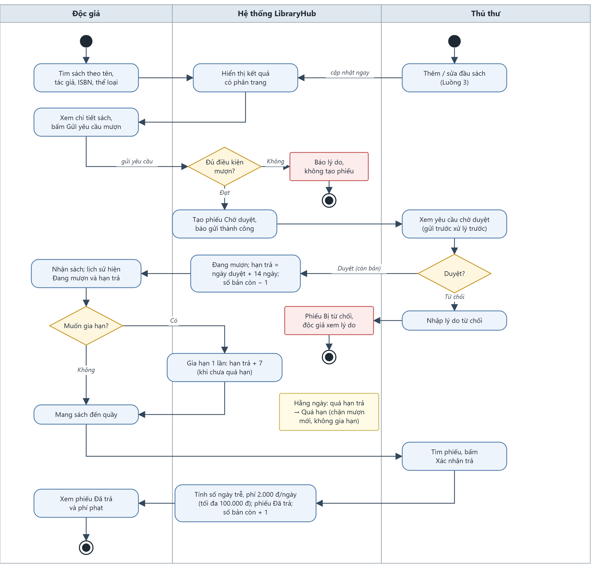

# TÀI LIỆU YÊU CẦU NGƯỜI SỬ DỤNG (URD)

**Hệ thống quản lý mượn – trả sách thư viện (LibraryHub)** · Phiên bản 2.0 · 28/10/2026  
Đơn vị chủ trì: Thư viện – Trường Đại học Việt Nhật · Người biên soạn: Mỵ Hiểu Minh (MSSV 23110198)

> Bản chính thức theo Biểu mẫu 03: `docs/URD.docx`. File này là bản Markdown cùng nội dung.

## 1 Giới thiệu

### 1.1 Mục đích tài liệu

Tài liệu Yêu cầu người sử dụng (URD) mô tả nhu cầu của thư viện đối với hệ thống quản lý mượn – trả sách **LibraryHub**: ai dùng hệ thống, họ cần làm những việc gì, theo luồng nghiệp vụ nào, dữ liệu nào cần ghi nhận và khi nào thì coi một yêu cầu là đạt.

Tài liệu là căn cứ cho các công việc sau:

- **Đặc tả và thiết kế:** là đầu vào để chi tiết hoá thành Tài liệu đặc tả yêu cầu phần mềm (SRS v2.0).
- **Lập trình:** xác định phạm vi chức năng, quy tắc nghiệp vụ và thông báo hiển thị.
- **Kiểm thử và nghiệm thu:** mỗi yêu cầu (US-xx) có tiêu chí nghiệm thu (AC) để viết trường hợp kiểm thử; các con số ở mục 2.3 và mục 5 là đầu vào cho kiểm thử hiệu năng.

### 1.2 Phạm vi và đối tượng sử dụng

**Trong phạm vi:** đăng ký và đăng nhập tài khoản; tra cứu sách; gửi yêu cầu mượn, gia hạn, trả sách và tính phí phạt; thủ thư duyệt hoặc từ chối yêu cầu; quản lý đầu sách; quản lý tài khoản; thống kê sách mượn nhiều và sách quá hạn.

**Ngoài phạm vi:** thanh toán phí phạt trực tuyến (phí được thu tại quầy, hệ thống chỉ ghi nhận số tiền); gửi email/SMS; đặt trước sách đã hết; quản lý nhiều chi nhánh; mã vạch/RFID; khôi phục mật khẩu qua email.

**Đối tượng sử dụng hệ thống:**

- **Khách (R-00):** người chưa đăng nhập; xem, tìm sách và đăng ký tài khoản.
- **Độc giả (R-01):** sinh viên, giảng viên có tài khoản; tìm sách, gửi yêu cầu mượn, gia hạn, xem lịch sử mượn của mình.
- **Thủ thư (R-02):** nhân viên thư viện; duyệt/từ chối yêu cầu, xác nhận trả sách, quản lý đầu sách, xem thống kê.
- **Quản trị viên (R-03):** người quản lý hệ thống; khoá/mở khoá tài khoản, đổi vai trò, xem thống kê.

**Đối tượng đọc tài liệu:** chủ hệ thống, người phát triển, tester (bạn cặp kiểm thử) và giảng viên học phần.

### 1.3 Từ điển thuật ngữ

| Thuật ngữ | Giải thích |
|---|---|
| Đầu sách | Một tựa sách, xác định bởi một mã ISBN; một đầu sách có thể có nhiều bản. |
| Bản sách | Một cuốn vật lý của đầu sách. "Còn X/Y bản" nghĩa là còn X bản trong kho trên tổng số Y bản. |
| Phiếu mượn | Bản ghi một lần mượn **một** bản sách của một độc giả, có mã dạng PM-YYYYMMDD-NNNN. |
| Yêu cầu mượn | Phiếu mượn ở trạng thái Chờ duyệt, do độc giả gửi trực tuyến. |
| Hạn trả | Ngày cuối cùng độc giả phải trả sách; trả trong ngày hạn trả vẫn là đúng hạn. |
| Quá hạn | Phiếu đang mượn mà ngày hiện tại đã sau hạn trả. |
| Gia hạn | Lùi hạn trả của phiếu đang mượn thêm một số ngày quy định. |
| Phí phạt | Tiền độc giả phải trả khi trả sách sau hạn; được thu tại quầy. |
| Phí tạm tính | Phí phạt tính đến ngày hiện tại của phiếu đang quá hạn, chưa phải số tiền chốt. |
| Ngày (trong quy tắc) | Ngày lịch theo múi giờ Việt Nam (UTC+7), không phân biệt ngày làm việc hay ngày nghỉ. |
| Khoá tài khoản | Tạm dừng quyền sử dụng hệ thống của một tài khoản; dữ liệu của tài khoản vẫn được giữ. |

*Bảng 1-1: Từ điển thuật ngữ*

### 1.4 Ký hiệu sử dụng

| Ký hiệu | Ý nghĩa |
|---|---|
| M | Mandatory — trường bắt buộc nhập |
| O | Optional — trường không bắt buộc |
| C | Conditional — trường bắt buộc khi thoả điều kiện ghi ở cột Ghi chú |
| US-xx | Yêu cầu người dùng (user story), ví dụ US-05 Gửi yêu cầu mượn |
| AC-xx.y | Tiêu chí nghiệm thu thứ y của US-xx, viết theo dạng Cho trước – Khi – Thì |
| FLOW-xx | Luồng nghiệp vụ liên chức năng |
| UR-BR-xx | Quy tắc nghiệp vụ ở mức người dùng (chi tiết hoá thành BUS-xx trong SRS) |
| UQ-xx | Yêu cầu chất lượng ở mức người dùng (chi tiết hoá thành NFR-xx trong SRS) |
| ERR-xx | Mã lỗi nghiệp vụ và thông báo hiển thị cho người dùng |
| BG-xx | Mục tiêu nghiệp vụ của hệ thống |
| SCR-xx | Mã màn hình giao diện |

*Bảng 1-2: Các ký hiệu sử dụng trong tài liệu*

Mức ưu tiên ở mục 6 được ghi bằng chữ ("Bắt buộc", "Nên có") để không nhầm với ký hiệu M/O/C của trường dữ liệu.

### 1.5 Căn cứ và tài liệu tham khảo

- Biểu mẫu 03 – URD, học phần Đánh giá hiệu năng, Trường Đại học Việt Nhật.
- Quy định mượn – trả sách của thư viện đã thống nhất với chủ hệ thống (các quy tắc UR-BR-01 đến UR-BR-08 ở mục 3).
- Tài liệu đặc tả yêu cầu phần mềm LibraryHub (SRS) phiên bản 2.0 – chi tiết hoá tài liệu này.
- Tài liệu API và Hướng dẫn vận hành, bàn giao của LibraryHub (đi kèm mã nguồn).

**Lịch sử phiên bản:**

| Phiên bản | Ngày | Nội dung thay đổi | Người thực hiện |
|---|---|---|---|
| 1.0 | 02/10/2026 | Nhu cầu, 12 user story và 3 luồng nghiệp vụ | Mỵ Hiểu Minh |
| 1.1 | 23/10/2026 | Thống nhất tác giả, liên kết tài liệu và mô tả dữ liệu bàn giao | Mỵ Hiểu Minh |
| 2.0 | 28/10/2026 | Trình bày lại theo Biểu mẫu 03: bổ sung hiện trạng, mức độ sử dụng, khung cảnh, ngữ cảnh, sơ đồ hoạt động, trường dữ liệu, trạng thái, mã lỗi và bảng tổng hợp. Nội dung nghiệp vụ không đổi so với 1.1. | Mỵ Hiểu Minh |

*Bảng 1-3: Lịch sử phiên bản tài liệu*

## 2 Mô tả chung về hệ thống

### 2.1 Mô tả hệ thống hiện tại

Thư viện hiện quản lý việc mượn – trả hoàn toàn thủ công:

- Danh mục sách được lưu trong bảng tính Excel trên một máy tại quầy; độc giả không tra cứu được từ xa.
- Khi mượn, độc giả đến quầy, thủ thư tìm sách trên kệ, ghi phiếu mượn vào sổ giấy (họ tên, mã sinh viên, tên sách, ngày mượn, hạn trả).
- Khi trả, thủ thư lật sổ tìm phiếu, tự đếm số ngày trễ và tự tính tiền phạt, sau đó gạch phiếu trong sổ.
- Không có tài khoản người dùng; mọi thao tác do thủ thư thực hiện.

### 2.2 Hạn chế của hệ thống hiện tại

Các số liệu dưới đây là ước tính của thư viện, dùng làm cơ sở đặt mục tiêu ở mục 2.4:

- Độc giả phải đến tận nơi mới biết sách còn hay hết; khoảng 30% lượt đến quầy là để hỏi sách nhưng sách đã hết.
- Giờ cao điểm đầu học kỳ, mỗi lượt mượn mất 5–10 phút do xếp hàng và ghi sổ.
- Tiền phạt tính tay dễ sai (đếm nhầm ngày, quên mức phạt tối đa); thư viện ước tính khoảng 1 trên 20 phiếu trả trễ bị tính sai.
- Không kiểm soát được giới hạn số sách một độc giả đang giữ và độc giả đang có sách quá hạn.
- Không có số liệu về sách được mượn nhiều hay danh sách phiếu quá hạn để nhắc độc giả và lên kế hoạch bổ sung sách.

### 2.3 Mức độ sử dụng và tăng trưởng giao dịch

|  |  |
|---|---|
| **Số giao dịch hiện tại** | Khoảng 120 lượt mượn/trả mỗi ngày; khoảng 1.500 lượt tra cứu sách mỗi ngày (dự kiến khi tra cứu trực tuyến). |
| **Tăng trưởng dự kiến** | Khoảng 10%/năm theo số sinh viên; danh mục ban đầu khoảng 60 đầu sách, bổ sung dần. |
| **Cao điểm** | Hai tuần đầu học kỳ và tuần trước kỳ thi: lưu lượng gấp khoảng 3 lần ngày thường, tập trung 8h–11h và 13h–16h. |
| **Số người dùng đồng thời tối đa** | Thường xuyên khoảng 50 người dùng đồng thời; cao điểm tối đa 100 người dùng đồng thời. |

*Bảng 2-1: Mức độ sử dụng và tăng trưởng giao dịch*

Các con số trên là đầu vào để đặt ngưỡng hiệu năng ở mục 5 và NFR-01 → NFR-05 của SRS.

### 2.4 Mục tiêu của hệ thống cần xây dựng

| Mã | Mục tiêu | Chỉ số đo |
|---|---|---|
| BG-01 | Độc giả tự tra cứu và gửi yêu cầu mượn trực tuyến | ≥ 80% yêu cầu mượn được tạo qua hệ thống |
| BG-02 | Loại bỏ sai sót khi tính phí phạt | Phí phạt do hệ thống tự tính; 0 thao tác tính tay |
| BG-03 | Thủ thư xử lý yêu cầu nhanh | Duyệt một yêu cầu trong tối đa 3 thao tác |
| BG-04 | Có số liệu phục vụ bổ sung sách và nhắc trả | Thống kê sách mượn nhiều, sách quá hạn xem được bất kỳ lúc nào |

*Bảng 2-2: Mục tiêu nghiệp vụ*

### 2.5 Khung cảnh dự án

| Giai đoạn | Thời gian | Nội dung chính |
|---|---|---|
| Khảo sát và đặc tả | Tuần 1 – 2 | Thu thập nhu cầu, lập URD và SRS, thống nhất quy tắc nghiệp vụ. |
| Xây dựng và triển khai | Tuần 3 – 5 | Lập trình giao diện và API, tạo dữ liệu mẫu, triển khai lên máy chủ. |
| Bàn giao | Tuần 6 | Bàn giao phiên bản cố định, đường dẫn truy cập, tài khoản thử và tài liệu cho bên kiểm thử. |
| Vận hành và kiểm thử | Tuần 6 – 13 | Hệ thống chạy liên tục; bên kiểm thử thực hiện kiểm thử chức năng và hiệu năng. Phiên bản không thay đổi trong giai đoạn này. |
| Nghiệm thu | Tuần 14 | Trình diễn, đối chiếu kết quả kiểm thử với tiêu chí nghiệm thu. |

*Bảng 2-3: Khung cảnh dự án*

### 2.6 Ngữ cảnh hệ thống

LibraryHub là ứng dụng web độc lập, không tích hợp với hệ thống đào tạo hay thanh toán. Các hệ thống liên quan:

| Hệ thống liên quan | Chiều kết nối | Nội dung trao đổi |
|---|---|---|
| Trình duyệt của người dùng (Chrome, Edge, Firefox) | Hai chiều (HTTPS) | Trang giao diện HTML/JS; dữ liệu JSON qua API `/api`; mã truy cập (token) của phiên đăng nhập. |
| Cơ sở dữ liệu PostgreSQL | Hai chiều (nội bộ máy chủ) | Tài khoản, đầu sách, phiếu mượn; chỉ ứng dụng truy cập trực tiếp. |
| Công cụ kiểm thử API/tải (Postman, JMeter) | Một chiều: công cụ → hệ thống | Gọi API JSON giống giao diện để kiểm thử chức năng và hiệu năng. |
| Dịch vụ giám sát thời gian hoạt động | Một chiều: dịch vụ → hệ thống | Gọi định kỳ `GET /api/health` để ghi nhận hệ thống còn hoạt động. |

*Bảng 2-4: Ngữ cảnh hệ thống — các hệ thống liên quan*

Hệ thống không gửi email/SMS và không kết nối cổng thanh toán.

### 2.7 Hiệu quả mong đợi

- Độc giả biết ngay sách còn hay hết và gửi yêu cầu mượn ở bất kỳ đâu, giảm lượt đến quầy không cần thiết.
- Thủ thư chỉ cần bấm Duyệt/Xác nhận trả; hạn trả, phí phạt và số bản còn lại do hệ thống tự cập nhật.
- Các quy tắc giới hạn 5 cuốn, chặn khi quá hạn và không mượn trùng được áp dụng tự động, nhất quán.
- Thư viện có số liệu sách mượn nhiều và danh sách quá hạn để bổ sung sách và nhắc độc giả.

## 3 Yêu cầu nghiệp vụ chi tiết

### 3.1 Sơ đồ hoạt động nghiệp vụ tương lai

Hình 3-1 thể hiện các bên tham gia (Độc giả, Hệ thống, Thủ thư), thứ tự công việc và các điểm rẽ nhánh của vòng đời một lần mượn sách, từ tìm sách đến trả sách.

*Hình 3-1: Sơ đồ hoạt động nghiệp vụ tương lai*

**Quy tắc nghiệp vụ đã thống nhất** (áp dụng cho mọi luồng bên dưới):

| Mã | Quy tắc |
|---|---|
| UR-BR-01 | Mỗi độc giả giữ tối đa **5** cuốn cùng lúc, tính cả các yêu cầu đang chờ duyệt. |
| UR-BR-02 | Thời hạn mượn là **14 ngày** kể từ ngày thủ thư duyệt. |
| UR-BR-03 | Mỗi phiếu được gia hạn **1 lần**, hạn trả lùi thêm **7 ngày** so với hạn trả hiện tại; chỉ gia hạn khi chưa quá hạn. |
| UR-BR-04 | Trả sau hạn bị phạt **2.000 đ/ngày**, tối đa **100.000 đ** mỗi phiếu. |
| UR-BR-05 | Độc giả đang có sách quá hạn thì không được mượn thêm. |
| UR-BR-06 | Chỉ cho mượn khi đầu sách còn bản; số bản còn lại chỉ thay đổi khi duyệt (giảm 1) và khi trả (tăng 1). |
| UR-BR-07 | Tài khoản bị khoá không đăng nhập và không thao tác được. |
| UR-BR-08 | Quản trị viên không được tự khoá hoặc tự đổi vai trò của chính mình. |

*Bảng 3-1: Quy tắc nghiệp vụ mức người dùng*

### 3.2 Luồng FLOW-01: Tìm sách → gửi yêu cầu mượn → thủ thư duyệt

**Tác nhân:** Khách, Độc giả, Thủ thư. **Kết quả:** phiếu mượn được duyệt (Đang mượn, có hạn trả) hoặc bị từ chối kèm lý do.

#### 3.2.1 Yêu cầu thông tin (các trường dữ liệu)

| TT | Tên trường (VIE) | Tên trường (ENG) | Định dạng | Bắt buộc | Ghi chú / quy tắc kiểm tra |
|---|---|---|---|---|---|
| 1 | Từ khoá tìm kiếm | q | Chuỗi | O | Tối đa 100 ký tự; khớp một phần, không phân biệt hoa thường, trên tên sách, tác giả hoặc ISBN. |
| 2 | Thể loại | category | Danh mục | O | Một trong 8 thể loại: Công nghệ thông tin, Kinh tế, Ngoại ngữ, Văn học, Khoa học tự nhiên, Kỹ năng, Tiếng Nhật, Khác. |
| 3 | Chỉ sách còn bản | available | Có/Không | O | Khi chọn, chỉ hiện đầu sách còn ít nhất 1 bản. |
| 4 | Sắp xếp | sort | Danh mục | O | "Mới nhất" (mặc định) hoặc "Tên A→Z". |
| 5 | Mã phiếu | code | Chuỗi | M | Hệ thống tự sinh dạng PM-YYYYMMDD-NNNN, NNNN là số thứ tự trong ngày bắt đầu từ 0001. |
| 6 | Đầu sách | bookId | Số nguyên | M | Đầu sách đang tồn tại, chưa bị xoá. |
| 7 | Ngày gửi yêu cầu | requestedAt | Ngày giờ | M | Hệ thống ghi khi độc giả gửi. |
| 8 | Ngày duyệt | approvedAt | Ngày giờ | C | Bắt buộc khi phiếu được duyệt. |
| 9 | Hạn trả | dueDate | Ngày | C | Bắt buộc khi phiếu được duyệt; = ngày duyệt + 14 ngày. |
| 10 | Lý do từ chối | rejectReason | Chuỗi | C | Bắt buộc khi từ chối; 5–200 ký tự. |
| 11 | Trạng thái | status | Danh mục | M | Theo Bảng 3-3. |

*Bảng 3-2: Yêu cầu thông tin của luồng FLOW-01*

#### 3.2.2 Trạng thái của đối tượng

| Trạng thái | Mô tả và điều kiện chuyển trạng thái |
|---|---|
| Chờ duyệt (PENDING) | Độc giả vừa gửi yêu cầu. Chuyển **Đang mượn** khi thủ thư duyệt và đầu sách còn bản; chuyển **Bị từ chối** khi thủ thư từ chối kèm lý do. |
| Đang mượn (BORROWING) | Đã duyệt, có hạn trả. Gia hạn được 1 lần (vẫn Đang mượn). Chuyển **Quá hạn** khi qua ngày hạn trả; chuyển **Đã trả** khi thủ thư xác nhận trả. |
| Quá hạn (OVERDUE) | Hệ thống tự chuyển khi ngày hiện tại đã sau hạn trả. Không gia hạn được. Chuyển **Đã trả** khi thủ thư xác nhận trả và chốt phí phạt. |
| Đã trả (RETURNED) | Trạng thái kết thúc; ghi ngày trả, số ngày quá hạn và phí phạt. Không thao tác tiếp. |
| Bị từ chối (REJECTED) | Trạng thái kết thúc; độc giả xem được lý do từ chối. Không thao tác tiếp. |

*Bảng 3-3: Các trạng thái của phiếu mượn*

Trạng thái của **đầu sách** theo số bản còn lại: **Còn sách** khi còn ít nhất 1 bản (hiển thị "Còn X/Y bản", nút gửi yêu cầu mượn bấm được); **Hết sách** khi còn 0 bản (nhãn "Hết sách", không gửi yêu cầu được).

#### 3.2.3 Mô tả các chức năng

**Chức năng 1: Tìm kiếm sách (US-03)**

- **Mô tả:** Khách và người dùng đã đăng nhập tìm sách theo từ khoá, lọc theo thể loại, tình trạng còn sách và sắp xếp kết quả.
- **Luồng xử lý:**
  - Người dùng nhập từ khoá và/hoặc chọn bộ lọc, bấm Tìm.
  - Hệ thống trả danh sách đầu sách phù hợp, có phân trang, kèm ảnh bìa, tên, tác giả, thể loại và "Còn X/Y bản".
  - Không có kết quả → hiện thông báo "Không tìm thấy sách phù hợp."
- **Quy tắc nghiệp vụ:** Không hiện đầu sách đã xoá; tổng số kết quả và số trang phải đúng với các điều kiện lọc đang áp dụng.
- **Tiêu chí nghiệm thu:**
  - AC-03.1: Khi nhập một phần tên sách (không phân biệt hoa thường, có dấu), thì danh sách hiện các sách có tên chứa từ khoá.
  - AC-03.2: Khi không có kết quả, thì hiển thị "Không tìm thấy sách phù hợp."
  - AC-03.3: Kết quả được phân trang; số trang và tổng số kết quả đúng với bộ lọc đang chọn.

**Chức năng 2: Xem chi tiết sách (US-04)**

- **Mô tả:** Xem đầy đủ thông tin một đầu sách để quyết định có mượn hay không.
- **Luồng xử lý:**
  - Người dùng bấm vào một sách trong kết quả tìm kiếm.
  - Hệ thống hiển thị ảnh bìa, tên, tác giả, ISBN, thể loại, nhà xuất bản, năm xuất bản, mô tả và "Còn X/Y bản".
  - Độc giả thấy nút "Gửi yêu cầu mượn"; khách thấy nút "Đăng nhập để mượn".
- **Quy tắc nghiệp vụ:** Sách còn 0 bản thì hiện "Hết sách" và nút gửi yêu cầu bị vô hiệu. Đường dẫn tới sách không tồn tại hoặc đã xoá → báo không tìm thấy sách.
- **Tiêu chí nghiệm thu:**
  - AC-04.1: Trang chi tiết hiển thị đủ các thông tin trên và "Còn X/Y bản".
  - AC-04.2: Khi sách đã hết bản, thì nút gửi yêu cầu mượn bị vô hiệu và hiện "Hết sách".

**Chức năng 3: Gửi yêu cầu mượn (US-05)**

- **Mô tả:** Độc giả gửi yêu cầu mượn một bản của đầu sách mà không cần đến quầy.
- **Luồng xử lý:**
  - Độc giả bấm "Gửi yêu cầu mượn" ở trang chi tiết sách.
  - Hệ thống kiểm tra lần lượt: giới hạn 5 cuốn (UR-BR-01) → có sách quá hạn (UR-BR-05) → đã có phiếu chưa kết thúc cho đầu sách này → còn bản (UR-BR-06).
  - Đạt cả 4 điều kiện → tạo phiếu Chờ duyệt, hiện "Gửi yêu cầu mượn thành công. Vui lòng chờ thủ thư duyệt."
  - Không đạt → báo đúng lý do của điều kiện đầu tiên không đạt, không tạo phiếu.
- **Quy tắc nghiệp vụ:** UR-BR-01, UR-BR-05, UR-BR-06; không gửi trùng yêu cầu cho cùng đầu sách khi phiếu trước chưa kết thúc. Gửi yêu cầu không làm thay đổi số bản còn lại.
- **Tiêu chí nghiệm thu:**
  - AC-05.1: Cho trước độc giả đủ điều kiện, khi gửi yêu cầu, thì có thông báo thành công và phiếu "Chờ duyệt" xuất hiện trong lịch sử.
  - AC-05.2: Cho trước độc giả đang giữ 5 cuốn (kể cả chờ duyệt), khi gửi tiếp, thì bị từ chối với thông báo ERR-04.
  - AC-05.3: Cho trước độc giả có sách quá hạn, khi gửi, thì bị từ chối với thông báo ERR-05.
  - AC-05.4: Độc giả không thể gửi hai yêu cầu cho cùng một đầu sách khi yêu cầu trước chưa kết thúc.

**Chức năng 4: Duyệt / từ chối yêu cầu mượn (US-08)**

- **Mô tả:** Thủ thư xử lý các yêu cầu chờ duyệt theo thứ tự gửi trước xử lý trước.
- **Luồng xử lý:**
  - Thủ thư mở danh sách "Yêu cầu chờ duyệt" (cũ nhất ở đầu), xem tên, email độc giả, tên sách, số bản còn, thời điểm gửi.
  - Bấm **Duyệt** → phiếu chuyển Đang mượn, hạn trả = ngày duyệt + 14 ngày, số bản còn lại giảm 1.
  - Hoặc bấm **Từ chối**, nhập lý do (5–200 ký tự) → phiếu chuyển Bị từ chối, độc giả thấy lý do.
- **Quy tắc nghiệp vụ:** UR-BR-02, UR-BR-06. Đầu sách hết bản lúc duyệt thì không duyệt được, phiếu giữ Chờ duyệt. Từ chối không làm thay đổi số bản còn lại. Hai thủ thư cùng duyệt bản cuối cùng thì chỉ một người thành công.
- **Tiêu chí nghiệm thu:**
  - AC-08.1: Khi duyệt, phiếu chuyển Đang mượn, hạn trả = ngày duyệt + 14 ngày, số bản còn giảm 1.
  - AC-08.2: Khi từ chối, bắt buộc nhập lý do; phiếu chuyển Bị từ chối; độc giả thấy lý do; số bản còn không đổi.
  - AC-08.3: Khi đầu sách đã hết bản lúc duyệt, thì không duyệt được và có thông báo.

#### 3.2.4 Bảng mã lỗi

| TT | Mã lỗi | Trường hợp phát sinh | Thông báo hiển thị cho người dùng |
|---|---|---|---|
| 1 | ERR-04 | Độc giả đang có 5 phiếu chưa kết thúc (Chờ duyệt, Đang mượn, Quá hạn) và gửi thêm yêu cầu. | Bạn đã mượn tối đa 5 cuốn. Vui lòng trả bớt sách trước khi mượn thêm. |
| 2 | ERR-05 | Độc giả có ít nhất một phiếu Quá hạn và gửi yêu cầu mới. | Bạn đang có sách quá hạn. Vui lòng trả sách trước khi mượn thêm. |
| 3 | ERR-06 | Độc giả đã có phiếu chưa kết thúc cho cùng đầu sách. | Bạn đã có yêu cầu hoặc đang mượn cuốn sách này. |
| 4 | ERR-07 | Đầu sách còn 0 bản khi gửi yêu cầu. | Sách đã hết, vui lòng quay lại sau. |
| 5 | ERR-07 | Đầu sách còn 0 bản khi thủ thư duyệt. | Sách đã hết, không thể duyệt. |
| 6 | ERR-08 | Thủ thư duyệt hoặc từ chối phiếu không còn ở trạng thái Chờ duyệt. | Chỉ duyệt được phiếu đang chờ duyệt. / Chỉ từ chối được phiếu đang chờ duyệt. |
| 7 | ERR-01 | Lý do từ chối ngắn hơn 5 hoặc dài hơn 200 ký tự. | Lý do từ chối từ 5 đến 200 ký tự |
| 8 | ERR-03 | Mở sách hoặc phiếu không tồn tại, đã xoá. | Không tìm thấy sách. / Không tìm thấy phiếu mượn. |
| 9 | ERR-09 | Phiên đăng nhập hết hạn trong lúc thao tác. | Phiên đăng nhập đã hết hạn. Vui lòng đăng nhập lại. |

*Bảng 3-4: Bảng mã lỗi của luồng FLOW-01*

### 3.3 Luồng FLOW-02: Trả sách → tính phí phạt quá hạn

**Tác nhân:** Thủ thư (độc giả có mặt tại quầy), Độc giả. **Kết quả:** phiếu chuyển Đã trả, phí phạt được chốt, số bản còn lại tăng 1. Luồng này bao gồm cả chức năng gia hạn và xem lịch sử mượn của độc giả trong thời gian giữ sách.

#### 3.3.1 Yêu cầu thông tin (các trường dữ liệu)

| TT | Tên trường (VIE) | Tên trường (ENG) | Định dạng | Bắt buộc | Ghi chú / quy tắc kiểm tra |
|---|---|---|---|---|---|
| 1 | Ô tìm phiếu | q | Chuỗi | O | Mã phiếu hoặc email độc giả; tối đa 100 ký tự; khớp một phần. |
| 2 | Lọc trạng thái | status | Danh mục | O | Chờ duyệt, Đang mượn, Quá hạn, Đã trả, Bị từ chối. |
| 3 | Hạn trả | dueDate | Ngày | M | Hiển thị dạng dd/mm/yyyy. |
| 4 | Số lần gia hạn | renewCount | Số nguyên | M | 0 hoặc 1. |
| 5 | Ngày trả | returnedAt | Ngày giờ | C | Bắt buộc khi phiếu Đã trả; hệ thống ghi lúc xác nhận. |
| 6 | Số ngày quá hạn | overdueDays | Số nguyên | M | ≥ 0; số ngày lịch từ hạn trả đến ngày trả (hoặc đến hôm nay nếu chưa trả). |
| 7 | Phí phạt | fine | Số tiền (đ) | M | = số ngày quá hạn × 2.000 đ, tối đa 100.000 đ; hiển thị dạng "2.000 đ". |

*Bảng 3-5: Yêu cầu thông tin của luồng FLOW-02*

#### 3.3.2 Trạng thái của đối tượng

Phiếu mượn dùng chung các trạng thái ở Bảng 3-3. Trong luồng này chỉ có các chuyển trạng thái: Đang mượn → Đang mượn (gia hạn), Đang mượn → Quá hạn (tự động), Đang mượn → Đã trả và Quá hạn → Đã trả.

#### 3.3.3 Mô tả các chức năng

**Chức năng 1: Xem lịch sử mượn (US-06)**

- **Mô tả:** Độc giả xem tất cả phiếu của chính mình để theo dõi hạn trả và phí phạt.
- **Luồng xử lý:**
  - Độc giả mở "Lịch sử mượn"; có thể lọc theo trạng thái.
  - Hệ thống hiển thị mã phiếu, tên sách, ngày yêu cầu, hạn trả, trạng thái, ngày trả, phí phạt và lý do từ chối (nếu có); mới nhất ở đầu.
- **Quy tắc nghiệp vụ:** Độc giả chỉ thấy phiếu của mình. Phiếu Quá hạn hiển thị phí tạm tính đến hôm nay theo UR-BR-04 (tối đa 100.000 đ).
- **Tiêu chí nghiệm thu:**
  - AC-06.1: Danh sách hiển thị đủ các cột trên; mới nhất ở đầu.
  - AC-06.2: Lọc được theo trạng thái.
  - AC-06.3: Độc giả chỉ thấy phiếu của chính mình; mở phiếu của người khác → báo không tìm thấy phiếu.

**Chức năng 2: Gia hạn sách (US-07)**

- **Mô tả:** Độc giả lùi hạn trả của một phiếu đang mượn để có thêm thời gian đọc.
- **Luồng xử lý:**
  - Ở Lịch sử mượn, độc giả bấm "Gia hạn" trên phiếu Đang mượn chưa gia hạn.
  - Hệ thống lùi hạn trả thêm 7 ngày so với hạn trả hiện tại, ghi đã gia hạn 1 lần và hiện "Gia hạn thành công. Hạn trả mới: dd/mm/yyyy."
- **Quy tắc nghiệp vụ:** UR-BR-03. Nút "Gia hạn" chỉ hiện với phiếu Đang mượn chưa gia hạn. Phiếu quá hạn hoặc đã gia hạn thì không gia hạn được.
- **Tiêu chí nghiệm thu:**
  - AC-07.1: Cho trước phiếu Đang mượn chưa gia hạn, khi bấm Gia hạn, thì hạn trả mới = hạn trả cũ + 7 ngày.
  - AC-07.2: Phiếu đã gia hạn một lần hoặc đang quá hạn thì không gia hạn được, có thông báo lý do.

**Chức năng 3: Xác nhận trả sách và tính phí phạt (US-09)**

- **Mô tả:** Thủ thư ghi nhận độc giả trả sách; hệ thống tự tính phí phạt.
- **Luồng xử lý:**
  - Thủ thư mở "Quản lý phiếu mượn", tìm theo mã phiếu hoặc email độc giả.
  - Hệ thống hiển thị phiếu, hạn trả, số ngày quá hạn và phí tạm tính.
  - Thủ thư bấm "Xác nhận trả" và xác nhận hộp thoại.
  - Hệ thống chốt số ngày quá hạn, phí phạt, chuyển phiếu Đã trả, tăng số bản còn 1 và hiện "Đã xác nhận trả sách. Phí phạt: X đ."
- **Quy tắc nghiệp vụ:** UR-BR-04, UR-BR-06. Chỉ xác nhận trả phiếu Đang mượn hoặc Quá hạn. Trả xong, nếu độc giả không còn phiếu quá hạn nào khác thì được mượn lại.
- **Tiêu chí nghiệm thu:**
  - AC-09.1: Trả đúng hoặc trước hạn thì phí phạt 0 đ.
  - AC-09.2: Trả trễ N ngày thì phí phạt = N × 2.000 đ, tối đa 100.000 đ (trễ 50 ngày và 51 ngày đều là 100.000 đ).
  - AC-09.3: Sau khi trả, số bản còn tăng 1, phiếu chuyển Đã trả.

#### 3.3.4 Bảng mã lỗi

| TT | Mã lỗi | Trường hợp phát sinh | Thông báo hiển thị cho người dùng |
|---|---|---|---|
| 1 | ERR-10 | Gia hạn phiếu đã gia hạn một lần. | Mỗi phiếu chỉ được gia hạn 1 lần. |
| 2 | ERR-08 | Gia hạn phiếu không ở trạng thái Đang mượn (quá hạn, chờ duyệt, đã trả…). | Chỉ gia hạn được phiếu đang mượn và chưa quá hạn. |
| 3 | ERR-08 | Xác nhận trả phiếu Chờ duyệt, Bị từ chối hoặc Đã trả. | Chỉ xác nhận trả được phiếu đang mượn hoặc quá hạn. |
| 4 | ERR-03 | Phiếu không tồn tại hoặc thuộc độc giả khác. | Không tìm thấy phiếu mượn. |
| 5 | ERR-01 | Giá trị lọc trạng thái không thuộc danh mục. | Trạng thái không hợp lệ |

*Bảng 3-6: Bảng mã lỗi của luồng FLOW-02*

### 3.4 Luồng FLOW-03: Thủ thư thêm sách mới → độc giả tìm thấy và mượn được

**Tác nhân:** Thủ thư, Độc giả. **Kết quả:** đầu sách mới xuất hiện ngay trong tìm kiếm và độc giả gửi yêu cầu mượn được (tiếp FLOW-01).

#### 3.4.1 Yêu cầu thông tin (các trường dữ liệu)

| TT | Tên trường (VIE) | Tên trường (ENG) | Định dạng | Bắt buộc | Ghi chú / quy tắc kiểm tra |
|---|---|---|---|---|---|
| 1 | ISBN | isbn | Chuỗi số | M | Đúng 13 chữ số; không trùng với đầu sách khác. |
| 2 | Tên sách | title | Chuỗi | M | 1–200 ký tự. |
| 3 | Tác giả | author | Chuỗi | M | 1–100 ký tự. |
| 4 | Thể loại | category | Danh mục | M | Một trong 8 thể loại (Bảng 3-2). |
| 5 | Nhà xuất bản | publisher | Chuỗi | O | Tối đa 100 ký tự. |
| 6 | Năm xuất bản | publishYear | Số nguyên | O | Từ 1900 đến năm hiện tại. |
| 7 | Tổng số bản | totalCopies | Số nguyên | M | 1–100. Khi sửa: không nhỏ hơn số bản đang cho mượn. |
| 8 | Mô tả | description | Chuỗi | O | Tối đa 2000 ký tự. |
| 9 | Ảnh bìa | coverUrl | URL | O | URL http/https, tối đa 500 ký tự; để trống → ảnh mặc định. |
| 10 | Số bản còn | availableCopies | Số nguyên | M | Hệ thống tự tính; khi thêm mới = tổng số bản; luôn trong khoảng 0 – tổng số bản. |

*Bảng 3-7: Yêu cầu thông tin của luồng FLOW-03*

#### 3.4.2 Trạng thái của đối tượng

| Trạng thái | Mô tả và điều kiện chuyển trạng thái |
|---|---|
| Còn sách | Số bản còn ≥ 1. Chuyển **Hết sách** khi bản cuối cùng được duyệt cho mượn. |
| Hết sách | Số bản còn = 0. Chuyển **Còn sách** khi có bản được trả hoặc thủ thư tăng tổng số bản. |
| Đã xoá | Thủ thư xoá đầu sách không còn phiếu Chờ duyệt/Đang mượn/Quá hạn. Không còn xuất hiện trong tìm kiếm và chi tiết; phiếu cũ vẫn giữ tên sách. |

*Bảng 3-8: Các trạng thái của đầu sách*

#### 3.4.3 Mô tả các chức năng

**Chức năng 1: Thêm, sửa, xoá đầu sách (US-10)**

- **Mô tả:** Thủ thư cập nhật danh mục sách để luôn đúng với kho.
- **Luồng xử lý:**
  - Thủ thư mở "Quản lý sách", bấm "Thêm sách" (hoặc "Sửa" trên một dòng), nhập dữ liệu theo Bảng 3-7, bấm Lưu.
  - Hệ thống kiểm tra từng trường; có lỗi → báo ngay tại ô tương ứng, không lưu.
  - Hợp lệ → lưu; đầu sách mới có số bản còn = tổng số bản và xuất hiện ngay trong tìm kiếm.
  - Xoá: hệ thống hỏi xác nhận trước khi xoá.
- **Quy tắc nghiệp vụ:** ISBN không trùng. Không xoá đầu sách đang có phiếu Chờ duyệt/Đang mượn/Quá hạn. Khi giảm tổng số bản, giá trị mới không được nhỏ hơn số bản đang cho mượn.
- **Tiêu chí nghiệm thu:**
  - AC-10.1: Thêm sách với ISBN trùng thì bị từ chối với thông báo "ISBN đã tồn tại."
  - AC-10.2: Không xoá được đầu sách đang có người mượn hoặc chờ duyệt.
  - AC-10.3: Sách mới thêm hoặc vừa sửa xuất hiện đúng ngay trong tìm kiếm và trang chi tiết.

#### 3.4.4 Bảng mã lỗi

| TT | Mã lỗi | Trường hợp phát sinh | Thông báo hiển thị cho người dùng |
|---|---|---|---|
| 1 | ERR-11 | ISBN trùng với đầu sách khác khi thêm hoặc sửa. | ISBN đã tồn tại. |
| 2 | ERR-12 | Giảm tổng số bản xuống dưới số bản đang cho mượn n. | Số bản không được nhỏ hơn số bản đang cho mượn (n). |
| 3 | ERR-13 | Xoá đầu sách còn phiếu Chờ duyệt/Đang mượn/Quá hạn. | Không thể xoá sách đang được mượn hoặc chờ duyệt. |
| 4 | ERR-01 | Trường dữ liệu không hợp lệ (ví dụ ISBN không đủ 13 chữ số). | Thông báo tại từng ô, ví dụ "ISBN gồm đúng 13 chữ số". |
| 5 | ERR-03 | Sửa hoặc xoá đầu sách không tồn tại. | Không tìm thấy sách. |

*Bảng 3-9: Bảng mã lỗi của luồng FLOW-03*

### 3.5 Luồng tài khoản, phân quyền và thống kê

Nhóm chức năng nền tảng dùng chung cho cả ba luồng trên: đăng ký, đăng nhập/đăng xuất, quản lý tài khoản và thống kê.

#### 3.5.1 Yêu cầu thông tin (các trường dữ liệu)

| TT | Tên trường (VIE) | Tên trường (ENG) | Định dạng | Bắt buộc | Ghi chú / quy tắc kiểm tra |
|---|---|---|---|---|---|
| 1 | Họ tên | fullName | Chuỗi | M | 2–50 ký tự sau khi bỏ khoảng trắng hai đầu; chỉ chữ cái (kể cả tiếng Việt) và khoảng trắng. |
| 2 | Email | email | Email | M | Đúng định dạng email, tối đa 100 ký tự; không trùng (không phân biệt hoa thường). |
| 3 | Số điện thoại | phone | Chuỗi số | M | Đúng 10 chữ số, bắt đầu bằng 0. |
| 4 | Mật khẩu | password | Chuỗi | M | 8–32 ký tự, có ít nhất 1 chữ cái và 1 chữ số; hiển thị dạng ẩn. |
| 5 | Xác nhận mật khẩu | confirmPassword | Chuỗi | M | Trùng với mật khẩu (chỉ khi đăng ký). |
| 6 | Vai trò | role | Danh mục | M | Độc giả, Thủ thư, Quản trị viên; tài khoản tự đăng ký luôn là Độc giả. |
| 7 | Trạng thái tài khoản | status | Danh mục | M | Hoạt động hoặc Bị khoá. |
| 8 | Khoảng thống kê | from, to | Ngày | O | Ngày có thật; từ ngày ≤ đến ngày; cách nhau tối đa 366 ngày; mặc định 30 ngày gần nhất. |

*Bảng 3-10: Yêu cầu thông tin của luồng tài khoản và thống kê*

#### 3.5.2 Trạng thái của đối tượng

| Trạng thái | Mô tả và điều kiện chuyển trạng thái |
|---|---|
| Hoạt động (ACTIVE) | Trạng thái khi tạo tài khoản. Chuyển **Bị khoá** khi quản trị viên khoá (không áp dụng cho chính tài khoản quản trị viên đang thao tác). |
| Bị khoá (LOCKED) | Không đăng nhập được; phiên đang mở bị vô hiệu ở thao tác kế tiếp. Chuyển **Hoạt động** khi quản trị viên mở khoá. |

*Bảng 3-11: Các trạng thái của tài khoản*

#### 3.5.3 Mô tả các chức năng

**Chức năng 1: Đăng ký tài khoản (US-01)**

- **Mô tả:** Khách tự tạo tài khoản Độc giả bằng email.
- **Luồng xử lý:**
  - Khách mở "Đăng ký", nhập họ tên, email, số điện thoại, mật khẩu, xác nhận mật khẩu.
  - Hệ thống kiểm tra tất cả các trường và báo **mọi** lỗi cùng lúc tại từng ô.
  - Hợp lệ → tạo tài khoản vai trò Độc giả, hiện "Đăng ký thành công. Vui lòng đăng nhập." và chuyển tới trang đăng nhập.
- **Quy tắc nghiệp vụ:** Email không trùng; mật khẩu được lưu ở dạng băm, không ai xem được.
- **Tiêu chí nghiệm thu:**
  - AC-01.1: Khi nhập đủ và đúng dữ liệu, thì tài khoản được tạo với vai trò Độc giả và người dùng được chuyển tới trang đăng nhập.
  - AC-01.2: Khi email đã được dùng (kể cả khác hoa thường), thì hệ thống báo "Email đã được sử dụng." và không tạo tài khoản.
  - AC-01.3: Khi mật khẩu ngắn hơn 8 ký tự hoặc không có cả chữ và số, thì hệ thống báo lỗi tại ô mật khẩu.

**Chức năng 2: Đăng nhập / đăng xuất (US-02)**

- **Mô tả:** Người dùng có tài khoản đăng nhập để dùng chức năng theo vai trò và đăng xuất để bảo vệ tài khoản.
- **Luồng xử lý:**
  - Người dùng nhập email và mật khẩu, bấm Đăng nhập.
  - Đúng → vào trang theo vai trò: Độc giả → trang Tìm sách, Thủ thư → trang Thủ thư, Quản trị viên → trang Quản trị; tên người dùng hiện ở thanh đầu trang.
  - Bấm Đăng xuất → phiên bị huỷ, quay về trang đăng nhập.
- **Quy tắc nghiệp vụ:** UR-BR-07. Phiên đăng nhập có hiệu lực 60 phút. Thiếu email hoặc mật khẩu, hoặc dữ liệu không đúng dạng chữ, thì báo lỗi nhập liệu.
- **Tiêu chí nghiệm thu:**
  - AC-02.1: Khi đăng nhập đúng, thì người dùng vào trang đúng vai trò và thấy tên mình ở thanh đầu trang.
  - AC-02.2: Khi sai email hoặc mật khẩu, thì hệ thống báo "Email hoặc mật khẩu không đúng." (không nói rõ sai trường nào).
  - AC-02.3: Cho trước tài khoản bị khoá, khi đăng nhập, thì hệ thống báo "Tài khoản đã bị khoá. Vui lòng liên hệ thư viện."
  - AC-02.4: Khi bấm Đăng xuất, thì quay về trang đăng nhập và không dùng lại được phiên cũ (kể cả bằng nút Back).

**Chức năng 3: Quản lý tài khoản (US-11)**

- **Mô tả:** Quản trị viên tìm tài khoản, khoá/mở khoá và đổi vai trò.
- **Luồng xử lý:**
  - Quản trị viên mở "Quản trị", tìm theo tên/email, lọc theo vai trò và trạng thái.
  - Bấm "Khoá"/"Mở khoá" hoặc chọn vai trò mới trên một dòng.
  - Hệ thống lưu thay đổi; tài khoản bị khoá mất quyền ngay ở thao tác kế tiếp.
- **Quy tắc nghiệp vụ:** UR-BR-07, UR-BR-08. Danh sách không bao giờ hiển thị mật khẩu.
- **Tiêu chí nghiệm thu:**
  - AC-11.1: Tài khoản bị khoá không đăng nhập được và phiên đang mở bị vô hiệu ở lần thao tác kế tiếp.
  - AC-11.2: Quản trị viên không thể tự khoá hoặc tự đổi vai trò của chính mình.

**Chức năng 4: Xem thống kê (US-12)**

- **Mô tả:** Thủ thư và quản trị viên xem số liệu tổng quan, sách mượn nhiều và phiếu quá hạn.
- **Luồng xử lý:**
  - Mở "Thống kê"; chọn khoảng thời gian (mặc định 30 ngày gần nhất).
  - Hệ thống hiển thị: tổng đầu sách, tổng bản, số phiếu theo từng trạng thái, tổng độc giả; tối đa 10 sách được mượn nhiều nhất; danh sách phiếu quá hạn.
- **Quy tắc nghiệp vụ:** Sách mượn nhiều tính theo số phiếu được duyệt trong khoảng đã chọn. Phiếu quá hạn kèm số ngày quá hạn và phí tạm tính, quá hạn lâu nhất ở đầu.
- **Tiêu chí nghiệm thu:**
  - AC-12.1: Hiển thị tối đa 10 sách được mượn nhiều nhất trong khoảng thời gian chọn.
  - AC-12.2: Hiển thị danh sách phiếu đang quá hạn, số ngày quá hạn và phí phạt tạm tính.
  - AC-12.3: Khoảng thời gian sai (từ ngày sau đến ngày, quá 366 ngày, hoặc ngày không có thật) thì báo "Khoảng thời gian không hợp lệ".

#### 3.5.4 Bảng mã lỗi

| TT | Mã lỗi | Trường hợp phát sinh | Thông báo hiển thị cho người dùng |
|---|---|---|---|
| 1 | ERR-01 | Dữ liệu đăng ký/đăng nhập không hợp lệ hoặc bỏ trống. | Thông báo tại từng ô, ví dụ "Email không hợp lệ", "Vui lòng nhập mật khẩu". |
| 2 | ERR-02 | Email đăng ký đã được sử dụng. | Email đã được sử dụng. |
| 3 | ERR-14 | Sai email hoặc mật khẩu khi đăng nhập. | Email hoặc mật khẩu không đúng. |
| 4 | ERR-15 | Tài khoản bị khoá đăng nhập hoặc đang thao tác. | Tài khoản đã bị khoá. Vui lòng liên hệ thư viện. |
| 5 | ERR-09 | Chưa đăng nhập hoặc phiên đã hết hạn/đã đăng xuất. | Phiên đăng nhập đã hết hạn. Vui lòng đăng nhập lại. |
| 6 | ERR-16 | Người dùng mở chức năng không thuộc vai trò của mình. | Bạn không có quyền thực hiện thao tác này. |
| 7 | ERR-17 | Quản trị viên tự khoá hoặc tự đổi vai trò của chính mình. | Bạn không thể khoá tài khoản của chính mình. / Bạn không thể đổi vai trò của chính mình. |
| 8 | ERR-01 | Khoảng thống kê không hợp lệ. | Khoảng thời gian không hợp lệ |

*Bảng 3-12: Bảng mã lỗi của luồng tài khoản và thống kê*

## 4 Yêu cầu giao diện và dữ liệu

**Danh sách màn hình** (mockup chi tiết ở SRS v2.0, mục 2.6):

| Mã | Màn hình | Người dùng | Nội dung chính |
|---|---|---|---|
| SCR-01 | Đăng nhập | Tất cả | Email, mật khẩu, nút Đăng nhập, liên kết Đăng ký. |
| SCR-02 | Đăng ký | Khách | Năm ô nhập, lỗi hiển thị dưới từng ô. |
| SCR-03 | Tìm sách (trang chủ) | Tất cả | Ô từ khoá, lọc thể loại, "Chỉ sách còn", sắp xếp; lưới sách có phân trang. |
| SCR-04 | Chi tiết sách | Tất cả | Thông tin sách, "Còn X/Y bản", nút gửi yêu cầu mượn. |
| SCR-05 | Lịch sử mượn | Độc giả | Bảng phiếu, lọc trạng thái, nút Gia hạn. |
| SCR-06 | Yêu cầu chờ duyệt | Thủ thư | Danh sách chờ duyệt, nút Duyệt/Từ chối, hộp thoại lý do. |
| SCR-07 | Quản lý phiếu mượn | Thủ thư | Tìm theo mã phiếu/email, lọc trạng thái, nút Xác nhận trả. |
| SCR-08 | Quản lý sách | Thủ thư | Bảng đầu sách, form Thêm/Sửa, xác nhận Xoá. |
| SCR-09 | Quản trị tài khoản | Quản trị viên | Tìm, lọc, Khoá/Mở khoá, đổi vai trò. |
| SCR-10 | Thống kê | Thủ thư, Quản trị viên | Thẻ tổng quan, sách mượn nhiều, phiếu quá hạn. |

*Bảng 4-1: Danh sách màn hình*

**Yêu cầu chung về giao diện:**

- Toàn bộ giao diện tiếng Việt có dấu, đúng chính tả; nhãn trạng thái phiếu: Chờ duyệt, Đang mượn, Quá hạn, Đã trả, Bị từ chối.
- Tiền hiển thị dạng "2.000 đ" (dấu chấm phân cách hàng nghìn, khoảng trắng trước "đ"); ngày hiển thị dạng dd/mm/yyyy.
- Dùng được trên điện thoại và máy tính: hiển thị đúng từ chiều rộng 360 px đến 1920 px, không phải cuộn ngang trang.
- Lỗi nhập liệu hiển thị ngay dưới ô tương ứng; thông báo thành công/thất bại hiển thị rõ ràng ở đầu nội dung hoặc trong hộp thoại.
- Thao tác không thể hoàn tác (xoá sách, xác nhận trả, từ chối) phải có hộp thoại xác nhận.

**Yêu cầu dữ liệu:**

- Ngày giờ theo múi giờ Việt Nam (UTC+7).
- Dữ liệu mẫu tối thiểu: ≥ 50 đầu sách, ≥ 10 độc giả, có sẵn phiếu ở mọi trạng thái. Bộ dữ liệu đi kèm mã nguồn gồm 60 đầu sách, 17 tài khoản (2 quản trị viên, 2 thủ thư, 13 độc giả kể cả tài khoản bị khoá) và 113 phiếu mượn; các ngày mẫu được tạo tương đối theo ngày nạp dữ liệu.
- Dữ liệu được lưu bền vững trong cơ sở dữ liệu; có thể nạp lại bộ dữ liệu mẫu để đưa hệ thống về trạng thái ban đầu khi kiểm thử.
- Không lưu và không hiển thị mật khẩu ở dạng đọc được.

## 5 Yêu cầu phi chức năng

| Nhóm yêu cầu | Nội dung |
|---|---|
| **Hiệu năng** (UQ-01, UQ-02) | Tìm kiếm phản hồi gần như tức thì kể cả giờ cao điểm khoảng 50 người dùng đồng thời; đăng nhập, xem chi tiết, xem lịch sử và gửi yêu cầu mượn không phải chờ lâu; hệ thống vẫn phục vụ được khi tải tăng tới 100 người dùng. Ngưỡng đo cụ thể: NFR-01 → NFR-05 trong SRS. |
| **Khả dụng** (UQ-03, UQ-04) | Dùng được trên điện thoại và máy tính (360 px – 1920 px, không cuộn ngang); giao diện tiếng Việt, tiền dạng "2.000 đ", ngày dạng dd/mm/yyyy (NFR-09, NFR-11). |
| **Bảo mật** (UQ-05) | Mật khẩu được băm; người dùng chỉ thấy dữ liệu của mình và chỉ dùng được chức năng của vai trò mình; phiên đăng nhập hết hạn sau 60 phút (NFR-06, NFR-07). |
| **Tương thích** | Chạy đúng trên Chrome, Edge, Firefox – 2 phiên bản mới nhất (NFR-10). |
| **Sẵn sàng và tin cậy** (UQ-06) | Hệ thống hoạt động liên tục từ tuần 6 đến tuần 14 (≥ 99% thời gian, mỗi lần gián đoạn ≤ 4 giờ); lỗi bất ngờ không làm dừng máy chủ và không lộ thông tin kỹ thuật (NFR-08, NFR-12). |
| **Sao lưu** | Có bộ dữ liệu mẫu và lệnh nạp lại để khôi phục cơ sở dữ liệu về trạng thái chuẩn; số bản còn của đầu sách luôn khớp với số phiếu đang mượn (NFR-13). |

*Bảng 5-1: Các yêu cầu phi chức năng*

## 6 Bảng tổng hợp các yêu cầu chức năng

| Mã YC | Tên yêu cầu | Mô tả ngắn | Ưu tiên |
|---|---|---|---|
| US-01 | Đăng ký tài khoản | Khách đăng ký bằng email để mượn sách trực tuyến. | Bắt buộc |
| US-02 | Đăng nhập / đăng xuất | Dùng chức năng theo vai trò và bảo vệ tài khoản. | Bắt buộc |
| US-03 | Tìm kiếm sách | Tìm theo tên, tác giả, ISBN, thể loại; lọc còn sách; sắp xếp; phân trang. | Bắt buộc |
| US-04 | Xem chi tiết sách | Xem thông tin và số bản còn lại để quyết định mượn. | Bắt buộc |
| US-05 | Gửi yêu cầu mượn | Độc giả gửi yêu cầu, hệ thống kiểm tra các quy tắc mượn. | Bắt buộc |
| US-06 | Xem lịch sử mượn | Độc giả xem phiếu của mình, hạn trả và phí phạt. | Bắt buộc |
| US-07 | Gia hạn sách | Lùi hạn trả 7 ngày, 1 lần, khi chưa quá hạn. | Nên có |
| US-08 | Duyệt / từ chối yêu cầu | Thủ thư kiểm soát việc cho mượn. | Bắt buộc |
| US-09 | Xác nhận trả sách | Thủ thư ghi nhận trả, hệ thống tự tính phí phạt. | Bắt buộc |
| US-10 | Quản lý đầu sách | Thêm, sửa, xoá đầu sách cho đúng với kho. | Bắt buộc |
| US-11 | Quản lý tài khoản | Khoá/mở khoá tài khoản và đổi vai trò. | Bắt buộc |
| US-12 | Xem thống kê | Sách mượn nhiều, phiếu quá hạn, số liệu tổng quan. | Nên có |

*Bảng 6-1: Bảng tổng hợp các yêu cầu chức năng*

**Truy vết URD → SRS:**

| Mã URD | Chức năng / use case SRS | Luồng | Yêu cầu phi chức năng |
|---|---|---|---|
| US-01 | FR-01 / UC-01 | – | NFR-06 |
| US-02 | FR-02 / UC-02 | FLOW-01, 02, 03 | NFR-02, NFR-07 |
| US-03 | FR-03 / UC-03 | FLOW-01, 03 | NFR-01, NFR-04, NFR-05 |
| US-04 | FR-04 / UC-04 | FLOW-01, 03 | NFR-02, NFR-05 |
| US-05 | FR-05 / UC-05 | FLOW-01, 03 | NFR-03 |
| US-06 | FR-06 / UC-06 | FLOW-01, 02 | NFR-02, NFR-11 |
| US-07 | FR-07 / UC-07 | FLOW-02 | – |
| US-08 | FR-08 / UC-08 | FLOW-01 | NFR-03, NFR-13 |
| US-09 | FR-09 / UC-09 | FLOW-02 | NFR-13 |
| US-10 | FR-10 / UC-10 | FLOW-03 | – |
| US-11 | FR-11 / UC-11 | – | NFR-07 |
| US-12 | FR-12 / UC-12 | – | – |
| UQ-01 → UQ-06 | – | – | NFR-01 → NFR-13 (Bảng 5-1) |

*Bảng 6-2: Truy vết từ URD sang SRS*
